<h1 align="center">⚔ Lufia Forge</h1>

  <b>An all-in-one editor for <i>Lufia &amp; the Fortress of Doom</i> (SNES, USA).</b> 
  Maps, events, cutscenes, dialogue, characters, items, spells, monsters, music, graphics and patches, all in one app, 
  with a docked BizHawk emulator to test your changes live.

  <a href="https://github.com/TequilaJosh/Lufia-Forge-Releases/releases"><b>⬇ Download the latest release</b></a>
  &nbsp;·&nbsp; <a href="#install">Install</a>
  &nbsp;·&nbsp; <a href="#features">Features</a>
  &nbsp;·&nbsp; <a href="https://github.com/TequilaJosh/Lufia-Forge-Releases/issues">Report a bug</a>

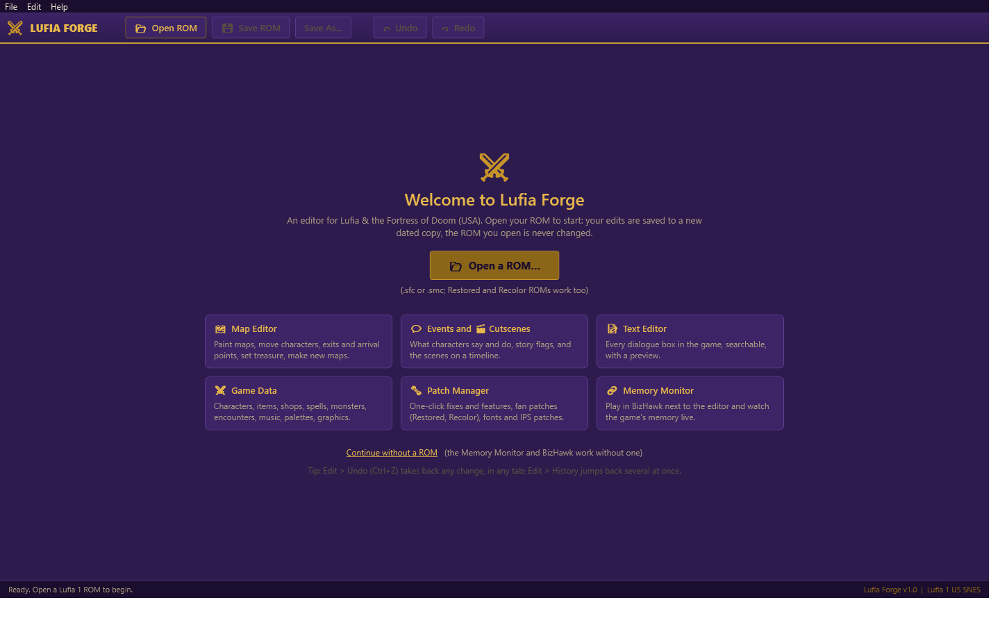

## Install

1. Open [Releases](https://github.com/TequilaJosh/Lufia-Forge-Releases/releases) and pick the newest version.
2. Download **LufiaForge-win-Setup.exe** and run it (Windows 10/11, 64-bit).
   Prefer no installer? Download **LufiaForge-win-Portable.zip** and unzip it anywhere.
3. Open your own copy of the ROM. Lufia Forge never overwrites it: every save is a new dated copy next to it.

Installed copies check for updates on start and update themselves (you're asked first, and warned if you have unsaved changes).
Beta builds (versions like `0.4.0-beta.10`) also receive newer betas; stable builds only receive stable releases.

No ROM is included. You need your own legally obtained copy of the game. Fan-patched ROMs (Lufia Restored, Lufia Recolor) work too.

## Features

- [The basics](#the-basics)
- [Map Editor](#map-editor) and [Block editor](#block-editor)
- [Events](#events) and the [Event editor](#event-editor)
- [Cutscenes](#cutscenes)
- [Text Editor](#text-editor)
- [Game Data](#game-data): characters, magic, growth, sprites, items, shops, spells, monsters, encounters, music, title screen, credits, palettes, graphics, settings
- [Patch Manager](#patch-manager)
- [Memory Monitor and BizHawk](#memory-monitor-and-bizhawk)
- [Disassembler](#disassembler)

---

### The basics

- **Safe saving:** Save ROM (Ctrl+S) writes a new file named with the date and time; the ROM you opened is never changed. The confirmation lists every change in that save. Save As (Ctrl+Shift+S) is there too. The checksum is fixed on every save.
- **Undo and redo for everything:** every change from any tab can be undone (Ctrl+Z) and redone (Ctrl+Y), up to 500 steps. **Edit > History** lists the recent changes with their times; click one to jump back (or forward) to it in one go.
- **Copier headers** are removed automatically; ROMs from other games are refused.
- **ROM Info** shows the header, checksum, size, and how the ROM has been edited: Lufia Forge's own changes, built-in patches, other known hacks, free space.
- **Welcome screen** with a short tour of every tab; the Memory Monitor works without a ROM.

---

### Map Editor

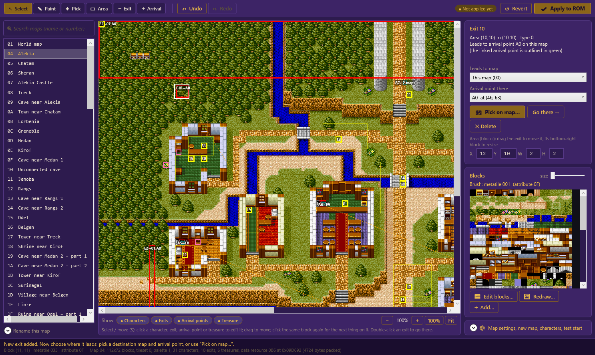

- **Every map**, including the world map, in a searchable list (by name or number). Town names come from the game, other maps are named from where they're entered, and you can rename any map.
- **Tools with one-key shortcuts:**
  - **Select / move** (S): click characters, exits, arrival points and treasure to edit them, drag to move. Click the same block again for the next thing on it; double-click an exit to go there.
  - **Paint** (B), **Pick block** (I), Ctrl+click to pick a block from the map.
  - **Area** (M): copy (Ctrl+C), cut (Ctrl+X), fill, delete, and paste (Ctrl+V) to stamp blocks anywhere.
  - **Add exit** (E) and **Add arrival point** (A).
- **Full undo / redo** of a map's edits (up to 300 steps, each named after what changed), Revert, and Apply to ROM. A badge shows when the map has edits that aren't applied yet.
- **Show / hide** characters, exits (with dotted lines to where they lead), arrival points, treasure and the world map's battle zones. Zoom with -, +, 100%, Fit or Ctrl+wheel; drag the map with the middle mouse button. Hovering describes what's under the mouse.
- **Characters:** position, sprite, a preview of what they say, open their event / dialogue in one click, add, hide or remove characters.
- **Exits:** pick the destination map and arrival point from lists or on the destination map itself (and place a new arrival point there), resize by dragging, delete.
- **Arrival points:** add, move, delete.
- **Treasure:** set the item in any chest or hidden spot, or gold (up to 64511 GP).
- **World map battle zones:** paint which battle group each 4x4 area uses.
- **Block graphics:** redraw blocks from a PNG, BMP or GIF (colours matched to the map's palette), or add a picture as new blocks.
- **Map settings:** tileset, palette and size; give a map its own copy of a tileset; **new maps** (a copy of the current one or a blank one).
- **Test start:** for testers, a new game can start at the Fortress of Doom, skip the prologue, or put the prologue party on any map.
- If an edit doesn't fit in the original 1 MB ROM, Lufia Forge offers to expand it (works in BizHawk, Snes9x and bsnes).

### Block editor

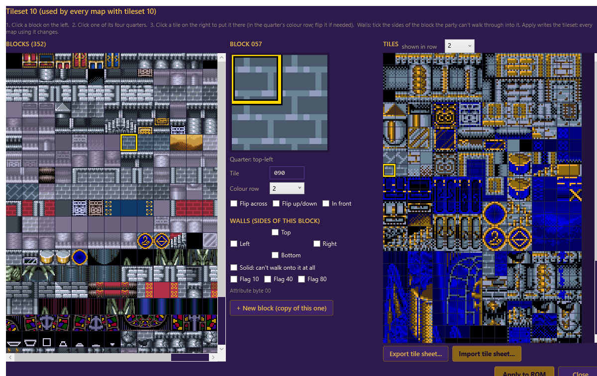

- Build each 16x16 block from four 8x8 tiles: tile, colour row, flip across / up-down, draw in front of characters.
- Set walls on each side, solid blocks and the other flags.
- Copy a block to make a new one.
- Export the tile sheet as a PNG, edit it in any paint program and import it back. Works for the world map's blocks too.

---

### Events

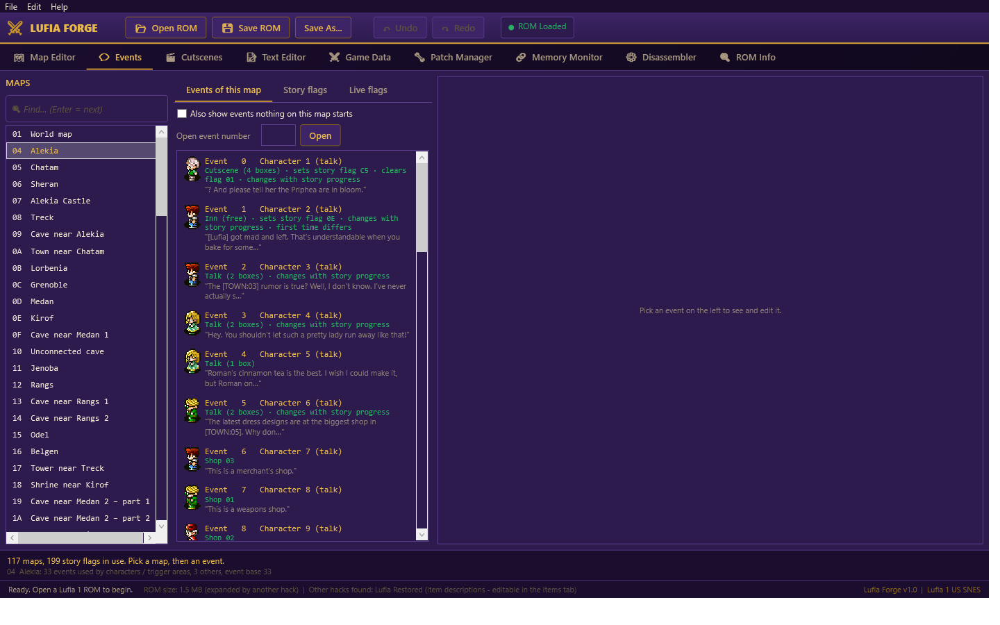

- Every event of every map, with what starts it (talking to a character, stepping on an area, story progress), the first line of dialogue, what it seems to do and the character's picture. Open any event by number.
- **Story flags:** find flags by number or name, give them your own names, see everywhere a flag is used (places that set it first), and list the **free flags** nothing in the game uses, ready for your own quests.
- **Live flags:** with BizHawk running the game, watch story flags and any memory address change live, with a log of every change (export to CSV). Import flag names and watches from CSV.

### Event editor

The same editor opens from the Map Editor, Events, Cutscenes and the Text Editor.

- **Lines view:** every command and dialogue box as a line. Drag lines to reorder, insert, delete, and edit every value with typed fields (flags, items, spells, maps, music...). Jump targets are picked by line.
- **Dialogue** with tags for names and things: [Hero], [Lufia], [Maxim]..., [ITEM:xx], [SPELL:xx], [TOWN:xx].
- **Every command** the game uses, in an Insert menu: flow and conditions (story flags, items, spells, level, HP, MP), characters (place, move along paths, join, leave, rename), camera and screen (scroll, fades, lightning, shaking), music and sound, waits, items and gold, warps, shops, inns, churches, battles, and more.
- **Flow view:** the event as a graph you can rearrange; drag a jump onto a card to retarget it.
- **Bytes view:** raw bytes, colour-coded, with jumps recalculated automatically.
- **Timeline:** tracks per character, camera, dialogue, screen and sound; drag blocks to change waits and durations; play it back, or follow the line BizHawk is running.
- Undo / redo, Revert, Apply (an event that grows is moved to free space automatically).

---

### Cutscenes

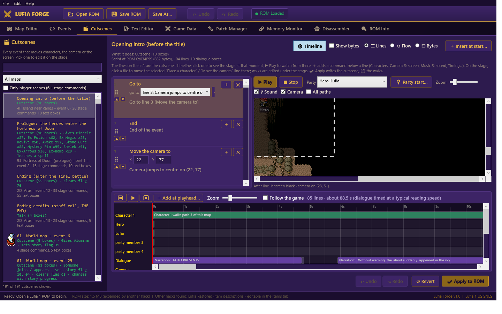

- Every scene that moves characters, the camera or the screen, on every map, with the known scenes (opening, prologue, ending, credits) first. Search and filter by map.
- **Stage preview:** the map with characters, walks and the camera at the selected line. Play the scene from any line, **with the music** (played by the game's own sound driver).
- Click or right-click the stage to move characters and the camera, make a character walk to a tile or turn to face it, and set where the party stands.
- **Walk paths:** draw steps on the stage, set speed and facing, repeat forever, camera follows, then write them to the ROM.

---

### Text Editor

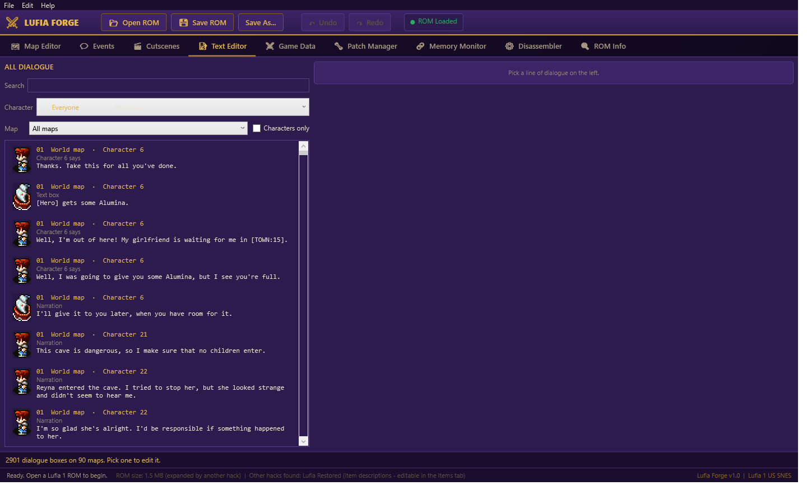

- **Every dialogue box in the game** in one list, with where it is, who says it, their picture and a preview.
- Search words, filter by map or by character (everything one character says, on every map), or only characters.
- Edit any box with the same tags as the event editor; edited boxes are marked. Open the whole event a line belongs to.
- **Export all dialogue** to a text file (great for proofreading or translating).

---

### Game Data

Grouped in a sidebar: Party, Items & magic, Battle, Sound, Look and Game. Every list has a **Find** box (type part of a name, Enter for the next match).

#### Party

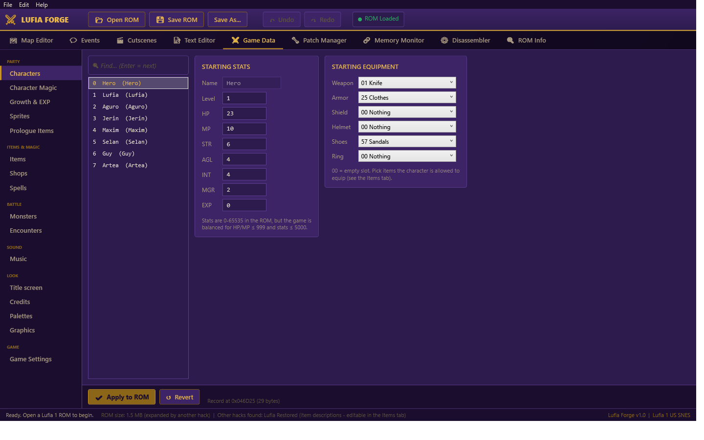

- **Characters:** name, starting level, HP, MP, STR, AGL, INT, MGR, EXP and starting equipment for all 8 playable characters.
- **Character Magic:** which spells each character learns and at what level (with the 128-spell patch: up to 64 spells per character, Aguro included).
- **Growth & EXP:** the EXP curve and stat growth for every band of level-ups, with a level-by-level preview table.
- **Sprites:** export and import every map sprite sheet as PNG, choose a sprite's palette row, make new sprites; export and import the battle sprites (party poses, command icons, digits, status icons).
- **Prologue Items:** what Maxim, Selan, Guy and Artea carry in the prologue.

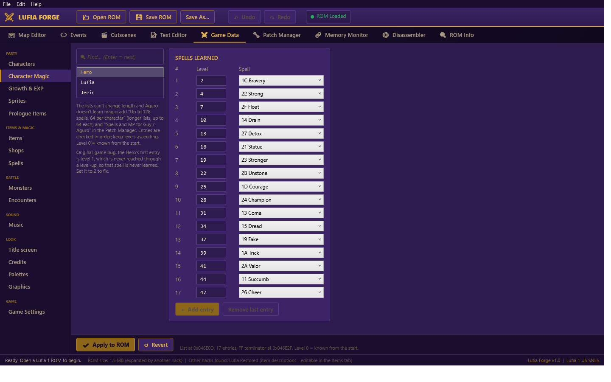 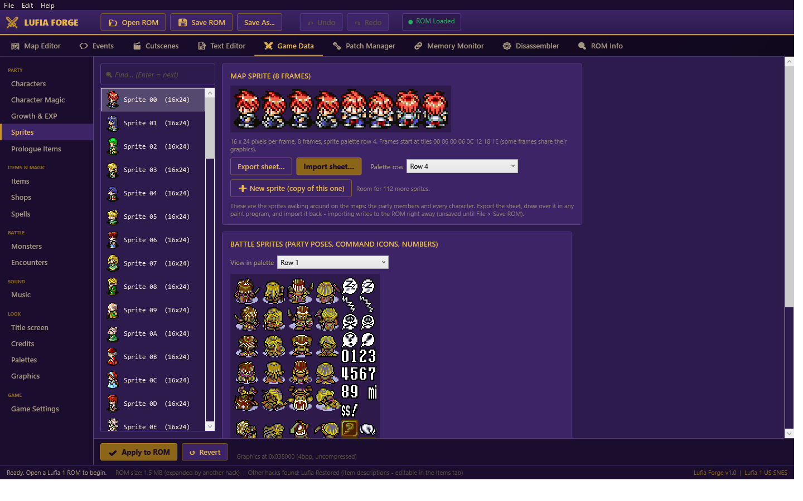

#### Items & magic

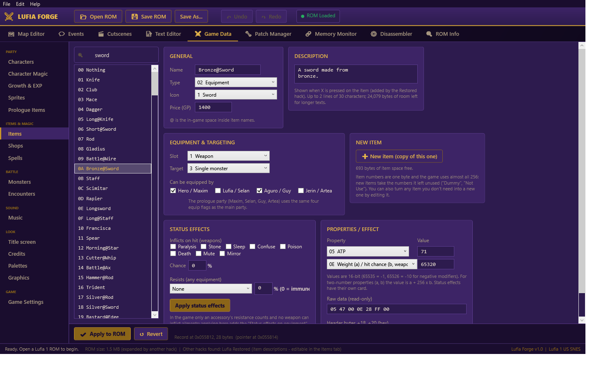

- **Items:** name, type, icon, price, description, equip slot, target, who can equip it, and every stat property.
  - **Status effects on equipment:** weapons can inflict Sleep, Poison, Confuse, Mute, Paralysis, Stone or Death on hit with a chance you set, and any armor, helmet, shield or accessory can resist ailments (in the original game only accessories counted).
  - **New items:** turn one of the game's unused item numbers into a copy of any item, then rename and change it.
- **Shops:** what each shop sells, by town.
- **Spells:** name, MP cost, field / battle use, target, element, power, success rate and other effect values.
  - **Light and Dark elements** for spells (and monster resistances to them).
  - **New spells** (up to 128 in total): copy a spell, rename it, choose what it does.
  - **Battle animations:** pick any animation and sound, export a spell's animation sheet, or **import your own 128x64 sheet as a new animation** (frame size, frame count, speed, centred or from the feet, screen flash).

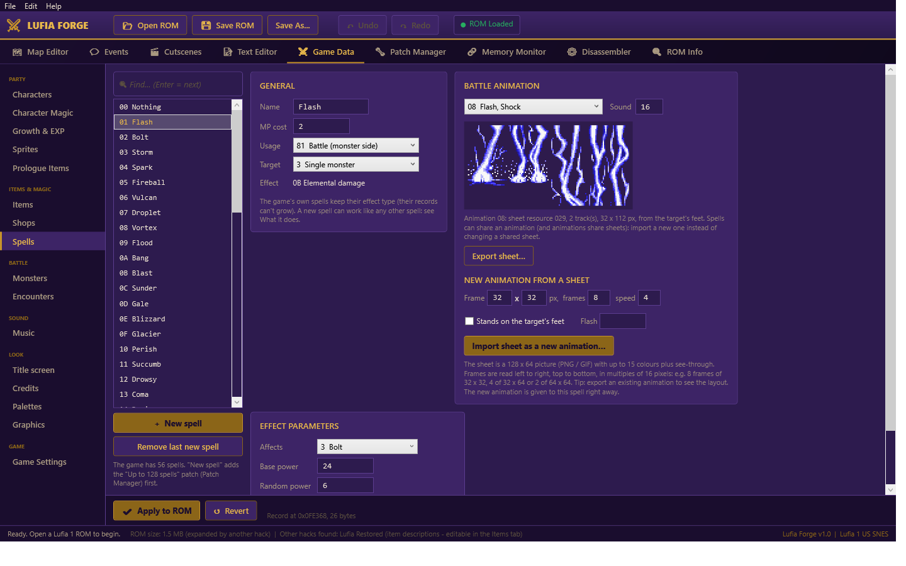 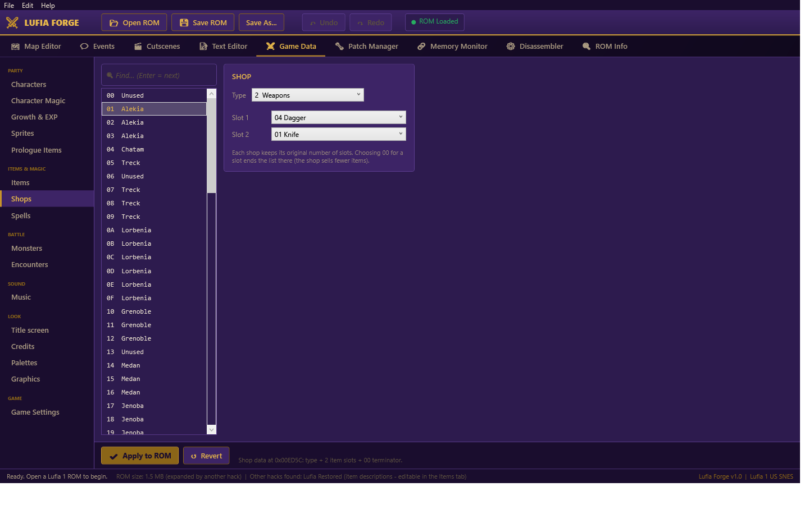

#### Battle

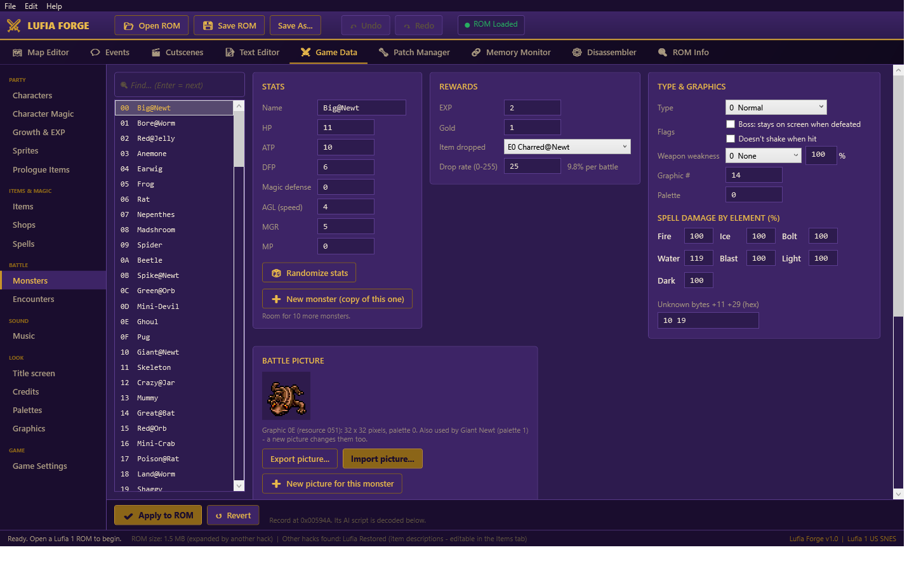

- **Monsters:** name, stats, EXP, gold, drops, type, boss and shake flags, weapon weakness and spell damage for every element (Fire, Ice, Bolt, Water, Blast, Light, Dark). Randomize stats in one click.
  - **Battle pictures:** export and import as PNG (up to 128x112), give a monster its own picture.
  - **New monsters:** copy any monster with its own AI.
  - **AI:** edit the script, or simply **give a monster spells** to cast a set share of its turns.
- **Encounters:** the monster groups of every battle group, which subgroups can roll and how likely, new groups and subgroups, boss formations, the group each town or dungeon uses, and **paint the world map's encounter zones** (with undo). A patch allows up to 255 subgroups.

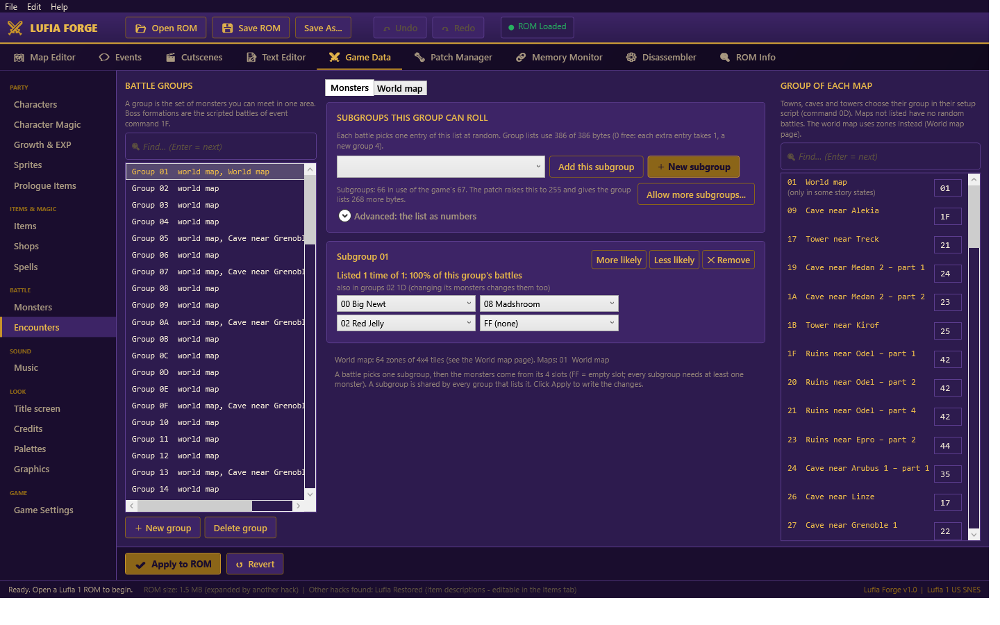

#### Sound

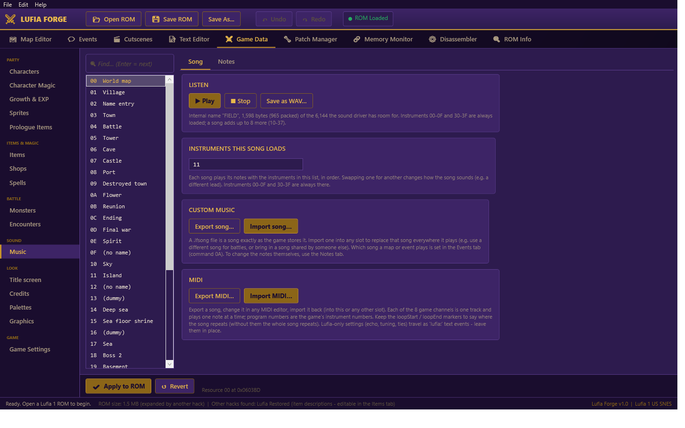

- **Listen** to all 37 songs, played by the game's own sound driver on an emulated SNES sound chip, and **save them as WAV**.
- Change the instruments a song loads.
- **Export and import songs** exactly as the game stores them, into any slot.
- **MIDI export and import:** one track per channel, loop markers, the game's instruments as program numbers.
- **Piano roll:** edit notes, drums, tempo, instruments, volume, pan and loops, with copy and paste, quantize, playback from any point, and undo / redo.

#### Look

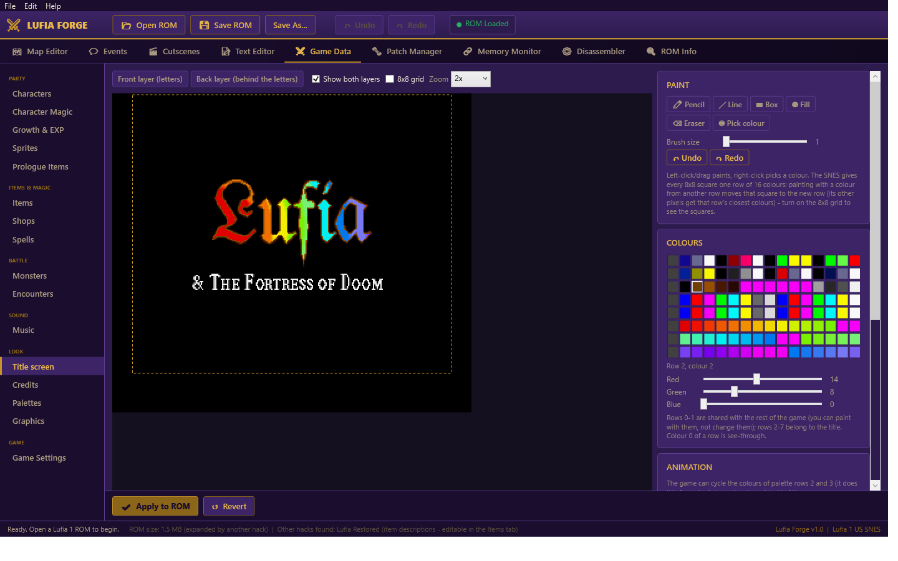

- **Title screen:** paint the logo and the colours behind it (pencil, line, box, fill, eraser, colour picker, undo / redo), edit its colours and the colour-cycling rainbow, export and import the layers as PNG.
- **Credits:** edit every card of the ending's staff roll with a preview as it shows on screen.
- **Palettes:** every map, sprite, battle and monster palette; edit colours as RGB or web colours, export and import as PNG.
- **Graphics:** browse every graphics resource (or raw bytes anywhere) as 2, 4 or 8 bpp with any palette; export and import PNG (resources that grow are moved to free space automatically).

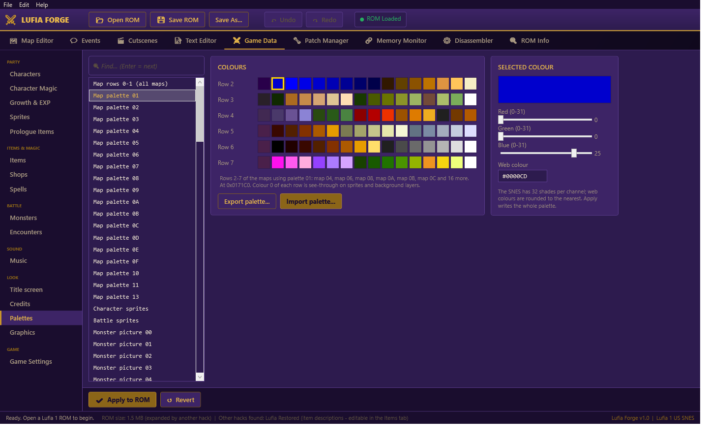 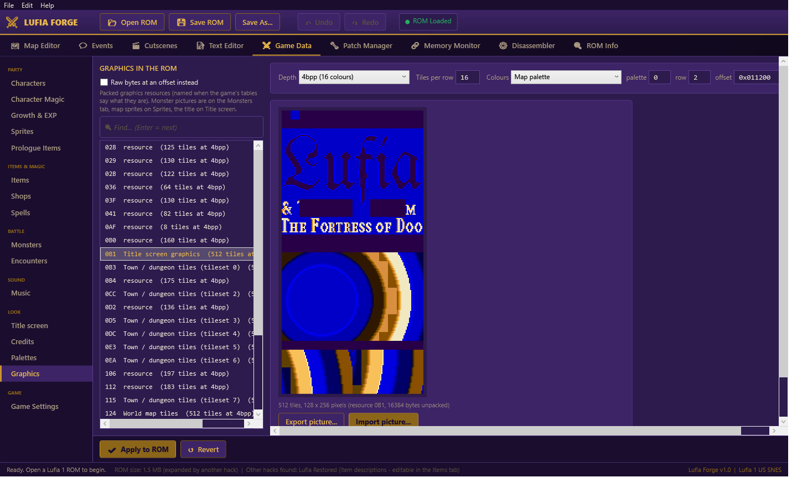

#### Game

- **Game Settings:** fast walking, sailing and flying; random battle rate presets (from Off to More) and safe steps after a battle; swamp damage; max level; the ROM's internal title.

---

### Patch Manager

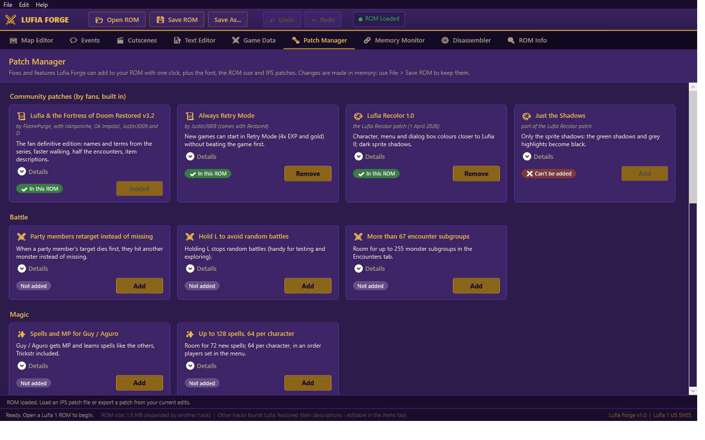

One-click fixes and features, each with a summary, a status badge (In this ROM, Update available, Not added) and an Add / Remove button:

- **Battle:** party members retarget instead of missing; hold L to avoid random battles; up to 255 encounter subgroups.
- **Magic:** spells and MP for Guy / Aguro (Trickstr included); up to 128 spells with 64 per character, in an order players set in the field Magic menu (kept in the save).
- **Items:** a 22 KB item bank for bigger item records and new items; status effects on equipment.
- **Events:** a rename command for events (show Maxim's name in a flashback, then give the Hero's back).
- **Testing:** test start (skip the opening, start anywhere).
- **Community patches built in:** Lufia & the Fortress of Doom Restored v3.2 (FlamePurge, with rainponcho, Ok Impala!, Justin3009 and D), Always Retry Mode (Justin3009), Lufia Recolor 1.0 and Just the Shadows. Their readmes come with the app.
- **Lufia II's font**, copied from your own Lufia II ROM (and Lufia 1's put back any time).
- **Expand the ROM** to 4 MB.
- **IPS patches:** apply someone's patch (with a warning if it would overwrite your Lufia Forge edits), or export your own edits as an IPS patch to share.

---

### Memory Monitor and BizHawk

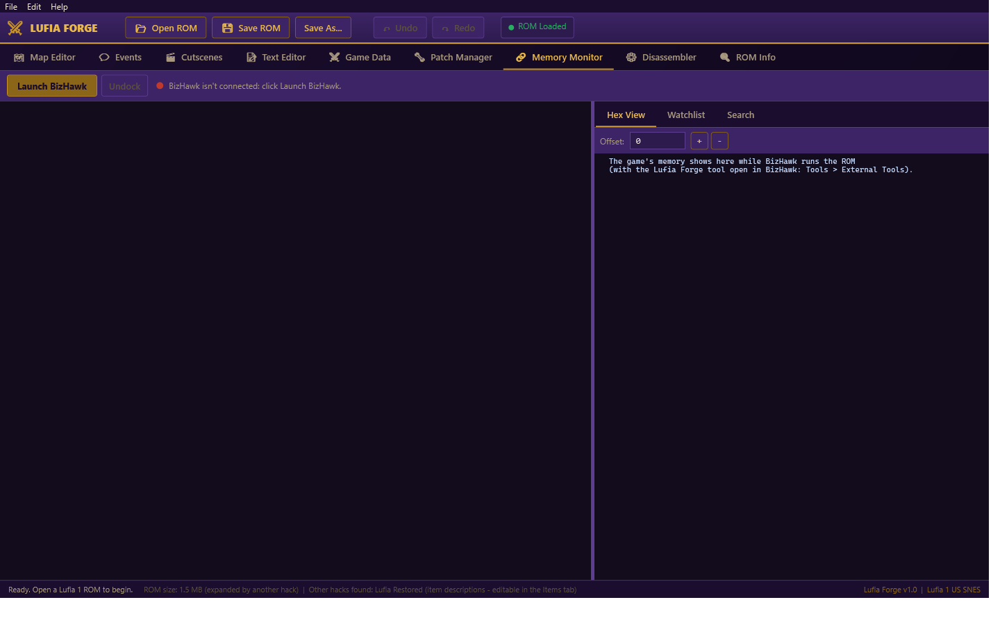

- **Launch BizHawk** (included) with the open ROM, docked right inside the window, or undocked to float on top.
- **Live memory view** of the game's RAM, refreshed 30 times a second.
- **Watchlist** with a catalog of known Lufia 1 addresses (HP, MP, gold, EXP, stats...), your own labels, and current, previous and change columns.
- **Value search** (cheat-finder style) to find any value in memory.
- The **Lufia Forge Monitor** tool inside BizHawk powers live flags, the cutscene "follow the game" playhead and the disassembler's "follow PC".

### Disassembler

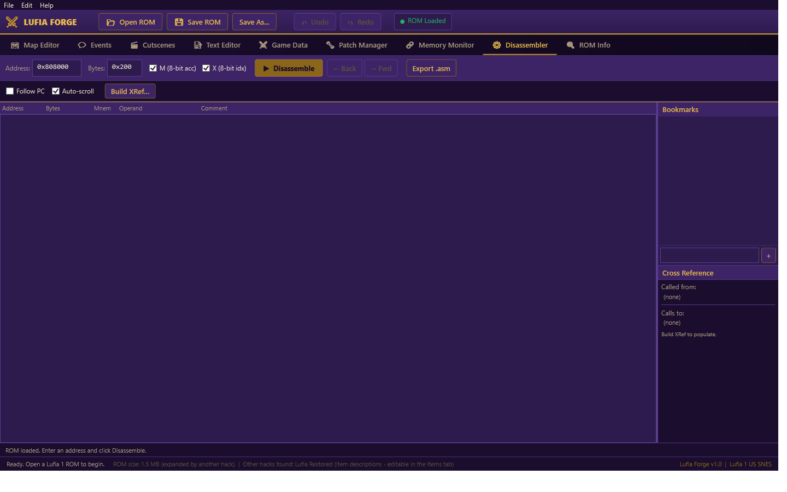

- 65816 disassembly from any SNES address or file offset, with back / forward navigation and export to .asm.
- **Follow PC** shows the code BizHawk is running right now.
- Follow jumps, bookmarks saved per ROM, a cross reference (called from / calls to), mark data, send addresses to the watchlist.

---

## Thanks

Lufia Forge builds on the work of the Lufia community: FlamePurge and everyone behind Lufia Restored, the Lufia Recolor patch, Justin3009, rainponcho, Ok Impala!, D, and the authors of L1ME. See Help > About & Thanks in the app for the full list.

## Feedback

This repository holds only the release files. Report problems or ideas on the [Issues](https://github.com/TequilaJosh/Lufia-Forge-Releases/issues) page: what you did, what you expected, and a save state if you can.

Lufia &amp; the Fortress of Doom is © Taito / Neverland. Lufia Forge is an unofficial fan tool and includes no game data; use it with your own copy of the game.
