<h1 align="center">⚔ Lufia Forge</h1>

  <b>An all-in-one editor for <i>Lufia &amp; the Fortress of Doom</i> and <i>Lufia II: Rise of the Sinistrals</i> (SNES, USA).</b> 
  Maps, events, cutscenes, dialogue, characters, items, spells, monsters, treasure, shops, music, graphics and patches, all in one app, 
  with a docked BizHawk emulator to test your changes live.

  <a href="https://github.com/TequilaJosh/Lufia-Forge-Releases/releases"><b>⬇ Download the latest release</b></a>
  &nbsp;·&nbsp; <a href="#install">Install</a>
  &nbsp;·&nbsp; <a href="#features">Features</a>
  &nbsp;·&nbsp; <a href="https://www.youtube.com/watch?v=mwXeeYYvAm4">Video</a>
  &nbsp;·&nbsp; <a href="docs/merge-projects.md">Merge guide</a>
  &nbsp;·&nbsp; <a href="https://github.com/TequilaJosh/Lufia-Forge-Releases/issues">Report a bug</a>

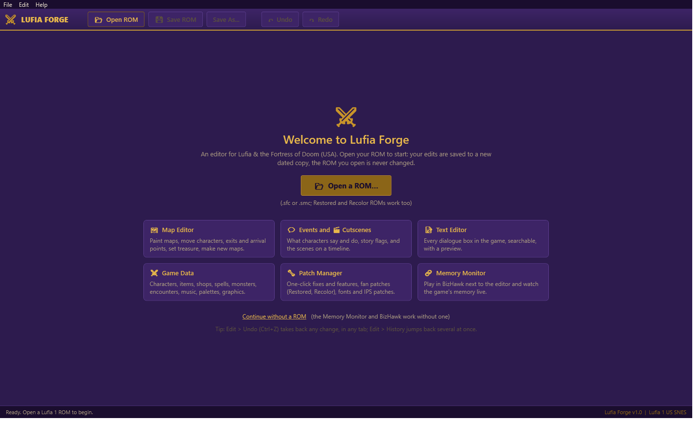

## See it in action

   
  The newest tools, made in the editor and recorded in the real game: cutscenes, the world map, treasure, new monsters, spell animations, capsule monsters, fan hacks and more.

## Install

1. Open [Releases](https://github.com/TequilaJosh/Lufia-Forge-Releases/releases) and pick the newest version.
2. Download **LufiaForge-win-Setup.exe** and run it (Windows 10/11, 64-bit).
   Prefer no installer? Download **LufiaForge-win-Portable.zip** and unzip it anywhere.
3. Start a **project** from your own copy of the ROM (Lufia 1 or Lufia II). Lufia Forge sees which game it is and shows that game's tools. The ROM you pick is never changed.

Installed copies check for updates on start and update themselves (you're asked first, and warned if you have unsaved changes).
Beta builds (versions like `0.4.0-beta.14`) also receive newer betas; stable builds only receive stable releases.

No ROM is included. You need your own legally obtained copy of the game. Fan-patched ROMs work too: Lufia Restored and Lufia Recolor for Lufia 1; Frue, Spekkio and Kureji Lufia and The Wrath of Foomy for Lufia II.

## Features

- [Everywhere](#everywhere): projects, undo, resizable and pop-out sections
- **Lufia & the Fortress of Doom**
  - [Map Editor](#map-editor) and [Block editor](#block-editor)
  - [Events](#events) and the [Event editor](#event-editor)
  - [Cutscenes](#cutscenes)
  - [Text Editor](#text-editor)
  - [Game Data](#game-data): characters, magic, growth, sprites, items, shops, spells, monsters, AI, encounters, visible monsters, battle backgrounds, music, title screen, credits, palettes, graphics, settings
  - [Patch Manager](#patch-manager): the Ancient Cave, visible monsters, community patches and more
- **Lufia II: Rise of the Sinistrals**
  - [Maps, treasure and the world map](#maps-treasure-and-the-world-map)
  - [Cutscenes, events and text](#cutscenes-events-and-text)
  - [Battle](#battle): monsters, encounters, items, spells, IP attacks, animations
  - [Heroes and capsule monsters](#heroes-and-capsule-monsters)
  - [Shops, music, graphics and settings](#shops-music-graphics-and-settings)
  - [Fan hacks](#fan-hacks) and the [Lufia II Patch Manager](#lufia-ii-patch-manager)
- [Memory Monitor and BizHawk](#memory-monitor-and-bizhawk)
- [Disassembler](#disassembler)

---

### Everywhere

- **Projects:** picking a ROM starts a project (File > New Project, or the welcome screen). It keeps the ROM you started from and only what you changed, in one .lfproj file, so moving or deleting the original ROM doesn't break it. Reopen recent projects with one click.
- **Your work is saved for you:** Save Project (Ctrl+S) any time; the project also saves itself every 5 minutes (waiting until you pause, never interrupting typing), and closing only asks when something isn't saved. Every save keeps the one before as a .bak.
- **No Apply buttons needed:** edits go into the ROM by themselves when you move on, save, export or play. One **Apply** button in the top bar writes every tab's edits at once if you want them in right away.
- **Export ROM** writes a playable ROM next to the project; launching BizHawk writes a fresh copy, so the game always has your latest changes. **IPS export** shares your edits as a patch.
- **Merge projects** (File > Merge Another Project Into This One): bring another project's work into yours, see every difference (by map, event by event), tick what goes in and settle conflicts. [Step-by-step guide](docs/merge-projects.md).
- **Undo and redo for everything** (Ctrl+Z / Ctrl+Y), with **Edit > History** to jump back to any recent change.
- **Resize** the sections of every tab by dragging the bands between them (double-click a band to reset it), or **pop a section out** into its own window to make it as big as you like or put it on another screen.
- **Hold the middle mouse button and drag** to move around any map.
- **Start from a Clean Slate** (Edit menu): takes the story out of a ROM (events, cutscenes, characters, treasure) so you can build a new one on the same maps, starting wherever you choose. Undo takes it back.
- **ROM Info** shows the header, checksum, size, and how the ROM has been edited: Lufia Forge's changes, built-in patches, known hacks, free space. Copier headers are removed automatically.

---

## Lufia & the Fortress of Doom

### Map Editor

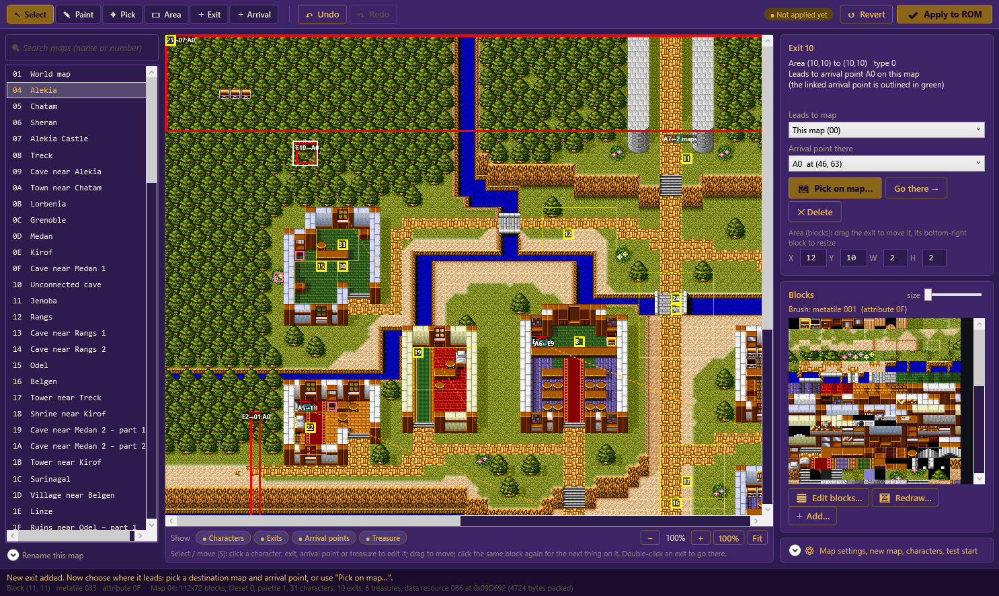

- **Every map**, including the world map, in a searchable list (by name or number). Town names come from the game, other maps are named from where they're entered, and you can rename any map (names belong to the project).
- **Tools with one-key shortcuts:**
  - **Select / move** (S): click characters, exits, arrival points and treasure to edit them, drag to move. Click the same block again for the next thing on it; double-click an exit to go there.
  - **Paint** (B), **Pick block** (I), Ctrl+click to pick a block from the map. The brush follows the mouse, see-through and snapped to the block it will paint; **Alt + mouse wheel** turns the brush block.
  - **Area** (M): copy (Ctrl+C), cut (Ctrl+X), fill, delete, and paste (Ctrl+V) to stamp blocks anywhere.
  - **Add exit** (E) and **Add arrival point** (A).
- **Building maps:**
  - **Buildings:** a gallery of ready-made houses, shops, rooms, castles and towers cut out of the game's own maps, shown as they'll look on your map. Click to place one, as often as you like.
  - **Your own presets:** select a piece of your map and **Save as preset**; it's in Buildings > My presets for every project.
  - **Pieces from other maps:** drag a rectangle on any map with the same tileset and stamp it.
  - **Goes with this block:** the blocks the game puts next to your brush, most used first, and a **Recent** row of brushes. The palette can be sorted by most used or show only this map's blocks.
  - **Make room for new blocks** on town tilesets that were full, without changing how the map looks.
- **Camera view:** a frame the size of the game screen shows what the player sees from any spot.
- **Full undo / redo** of a map's edits (up to 300 steps, each named after what changed) and Revert.
- **Show / hide** characters, exits (with dotted lines to where they lead), arrival points, treasure and the world map's battle zones. Zoom with -, +, 100%, Fit or Ctrl+wheel. Hovering describes what's under the mouse.
- **Characters:** position, sprite, a preview of what they say, open their event / dialogue in one click, add, hide or remove characters.
- **Exits:** pick the destination map and arrival point from lists or on the destination map itself, resize by dragging, delete.
- **Treasure:** set the item in any chest or hidden spot, or gold (up to 64511 GP).
- **World map battle zones:** paint which battle group each 4x4 area uses.
- **Block graphics:** redraw blocks from a PNG, BMP or GIF (colours matched to the map's palette), or add a picture as new blocks.
- **Map settings:** tileset, palette and **Resize map**; give a map its own copy of a tileset; **new maps** (a copy of the current one or a blank one).
- **Test start:** a new game can start at the Fortress of Doom, skip the prologue, or put the prologue party on any map.
- If an edit doesn't fit in the original 1 MB ROM, Lufia Forge offers to expand it (works in BizHawk, Snes9x and bsnes).

### Block editor

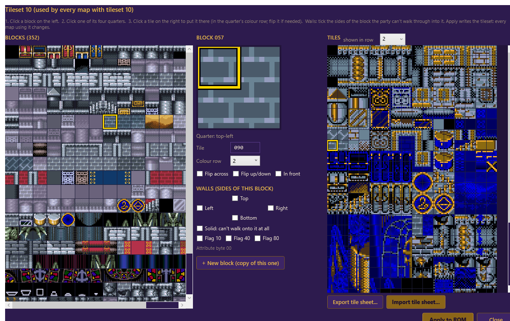

- Build each 16x16 block from four 8x8 tiles: tile, colour row, flip across / up-down, draw in front of characters.
- Set walls on each side, solid blocks and the other flags.
- Copy a block to make a new one.
- Export the tile sheet as a PNG, edit it in any paint program and import it back. Works for the world map's blocks too.

---

### Events

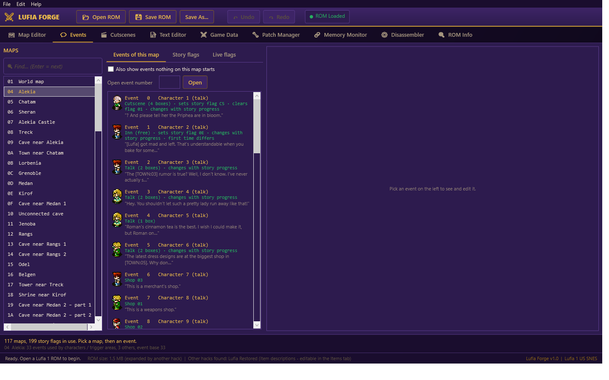

- Every event of every map (your own maps too), with what starts it (talking to a character, stepping on an area, story progress), the first line of dialogue, what it seems to do and the character's picture. Open any event by number.
- **Story flags:** find flags by number or name, give them your own names, see everywhere a flag is used, and list the **free flags** nothing in the game uses, ready for your own quests.
- **Live flags:** with BizHawk running the game, watch story flags and any memory address change live, with a log of every change (export to CSV). Import flag names and watches from CSV.

### Event editor

The same editor opens from the Map Editor, Events, Cutscenes and the Text Editor.

- **Lines view:** every command and dialogue box as a line. Drag lines to reorder, insert, delete, and edit every value with typed fields (flags, items, spells, maps, music...). Jump targets are picked by line.
- **Dialogue** with tags for names and things: [Hero], [Lufia], [Maxim]..., [ITEM:xx], [SPELL:xx], [TOWN:xx].
- **Every command** the game uses, in an Insert menu: flow and conditions (story flags, items, spells, level, HP, MP), characters (place, move along paths, join, leave, rename), camera and screen (scroll, fades, lightning, shaking), music and sound, waits, items and gold, warps, shops, inns, churches, battles, **emote bubbles** (!, ?, a heart, sweat, music...) and more.
- **Flow view:** the event as a graph you can rearrange; drag a jump onto a card to retarget it.
- **Bytes view:** raw bytes, colour-coded, with jumps recalculated automatically.
- **Timeline:** tracks per character, camera, dialogue, screen and sound; drag blocks to change waits and durations; play it back, or follow the line BizHawk is running.
- An event that grows is moved to free space automatically.

---

### Cutscenes

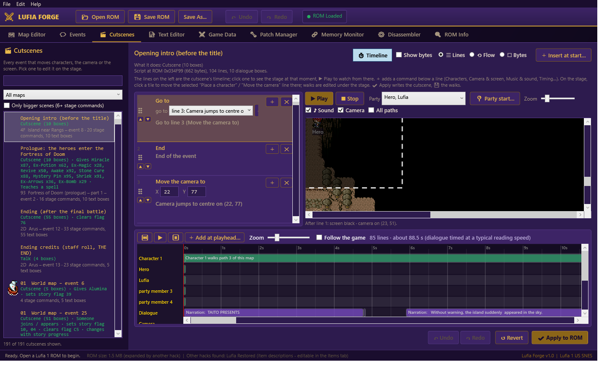

- Every scene that moves characters, the camera or the screen, on every map, with the known scenes (opening, prologue, ending, credits) first. Search and filter by map.
- **Stage preview:** the map with characters, walks and the camera at the selected line. Play the scene from any line, **with the music** (played by the game's own sound driver).
- Click or right-click the stage to move characters and the camera, make a character walk to a tile or turn to face it, and set where the party stands.
- **Walk paths:** draw steps on the stage, set speed and facing, repeat forever, camera follows, then write them to the ROM.

---

### Text Editor

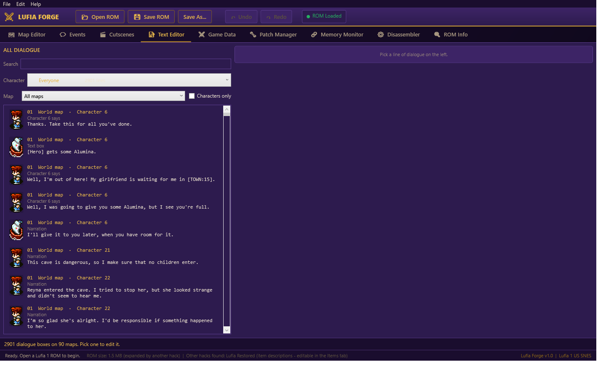

- **Every dialogue box in the game** in one list, with where it is, who says it, their picture and a preview.
- Search words, filter by map or by character (everything one character says, on every map), or only characters.
- Edit any box with the same tags as the event editor; edited boxes are marked. Open the whole event a line belongs to.
- **Export all dialogue** to a text file (great for proofreading or translating).

---

### Game Data

Grouped in a sidebar: Party, Items & magic, Battle, Sound, Look and Game. Every list has a **Find** box (type part of a name, Enter for the next match).

#### Party

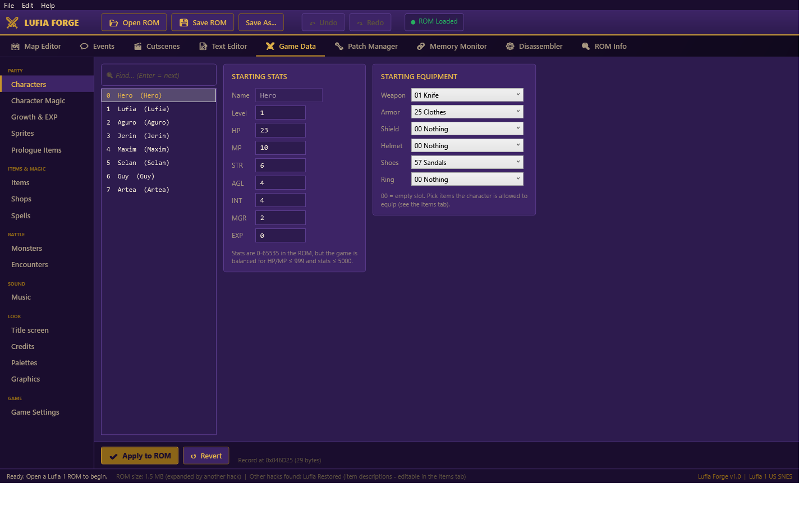

- **Characters:** name, starting level, HP, MP, STR, AGL, INT, MGR, EXP and starting equipment for all 8 playable characters.
- **Character Magic:** which spells each character learns and at what level (with the 128-spell patch: up to 64 spells per character, Aguro included).
- **Growth & EXP:** the EXP curve and stat growth for every band of level-ups, with a level-by-level preview table.
- **Sprites:** export and import every map sprite sheet as PNG, choose a sprite's palette row, make new sprites; export and import the battle sprites (party poses, command icons, digits, status icons).
- **Prologue Items:** what Maxim, Selan, Guy and Artea carry in the prologue.

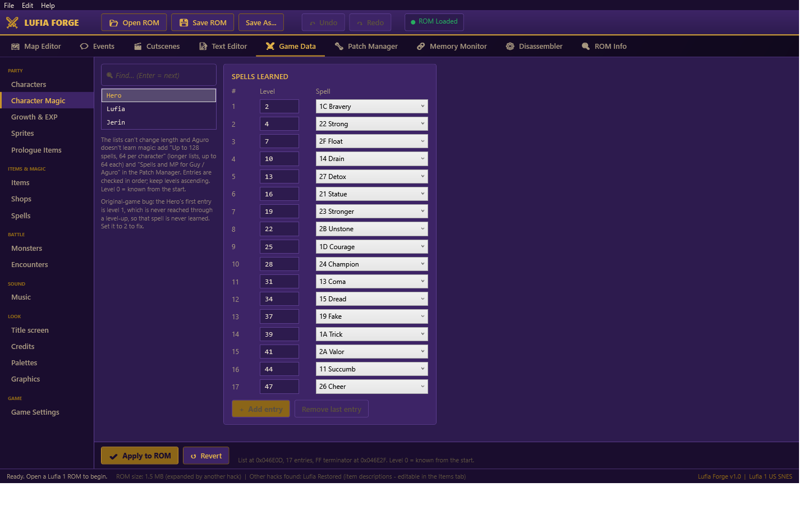 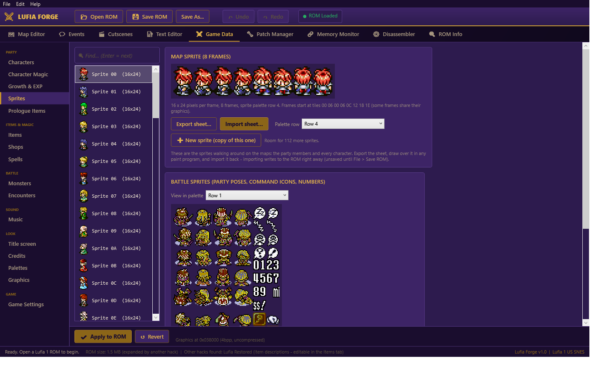

#### Items & magic

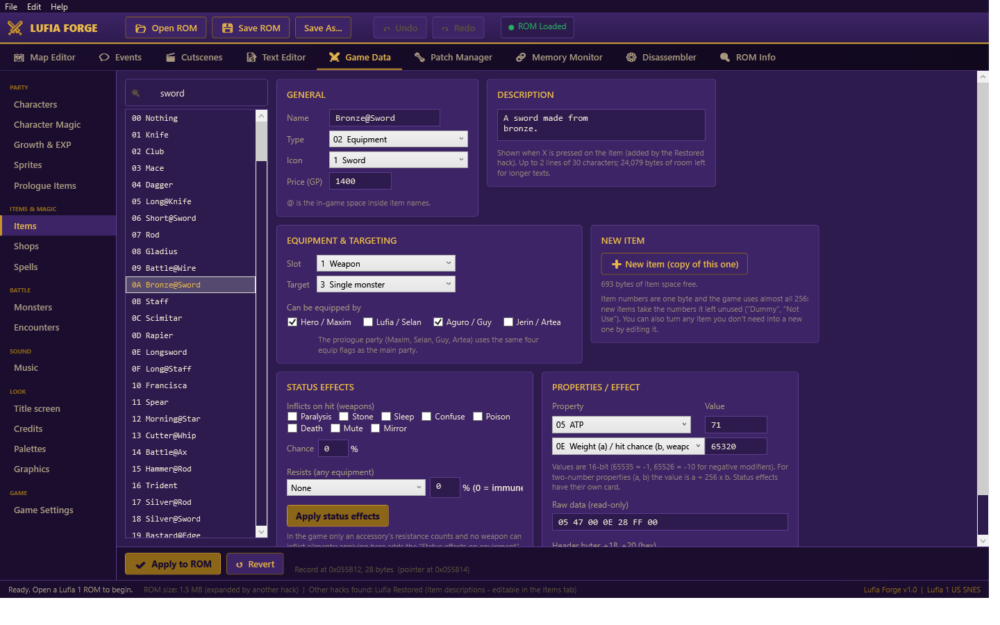

- **Items:** name, type, icon, price, description, equip slot, target, who can equip it, and every stat property.
  - **Status effects on equipment:** weapons can inflict Sleep, Poison, Confuse, Mute, Paralysis, Stone or Death on hit with a chance you set, and any armor, helmet, shield or accessory can resist ailments.
  - **New items:** turn one of the game's unused item numbers into a copy of any item, then rename and change it.
- **Shops:** what each shop sells, by town, and **new shops**.
- **Spells:** name, MP cost, field / battle use, target, element, power, success rate and other effect values.
  - **Light and Dark elements** for spells (and monster resistances to them).
  - **New spells** (up to 128 in total): copy a spell, rename it, choose what it does.
  - **Battle animations:** pick any animation and sound, or make a **new animation from your own picture** (a sheet with a frame grid and a playing preview; start, middle and end parts can come from several sheets).

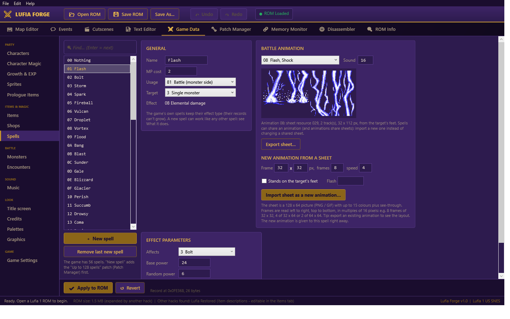 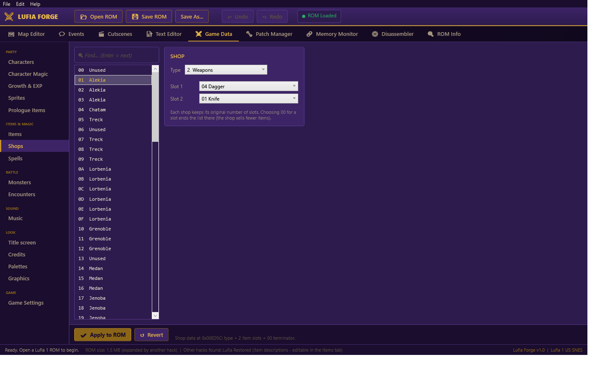

#### Battle

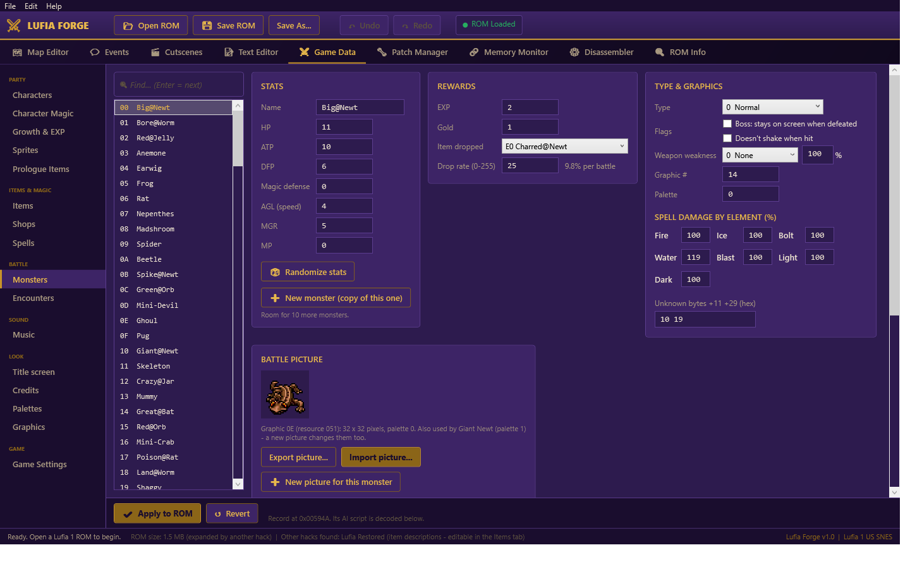

- **Monsters:** name, stats, EXP, gold, drops, type, boss and shake flags, weapon weakness and spell damage for every element (Fire, Ice, Bolt, Water, Blast, Light, Dark). Randomize stats in one click.
  - **Battle pictures:** export and import as PNG (up to 128x112), give a monster its own picture.
  - **New monsters:** copy any monster with its own AI.
- **Smarter monsters (boss AI for any monster):** **Edit AI script** shows a monster's script as steps in plain words; pick commands from a list, add, delete and move steps. On top of the game's own commands:
  - checks: a party member's HP below X%, turn N or later, every N turns, the only monster left, N or fewer party members standing, a hero's level, HP, MP or status;
  - targets: the party member with the lowest or highest HP, or by any value;
  - **phases:** 8 switches per monster to change tactics during a fight;
  - **several actions a turn** (up to 8, each with its own target), bonus damage, and Ok Impala's AI extensions;
  - or simply **give a monster spells** to cast a set share of its turns. Every monster has room for its AI.
- **Encounters:** the monster groups of every battle group, which subgroups can roll and how likely, new groups and subgroups, boss formations, the group each town or dungeon uses, and **paint the world map's encounter zones**. A patch allows up to 255 subgroups.
- **Visible monsters (Lufia 2 style):** monsters you can see walk around dungeon maps and start a fight when they reach the party. Lufia 2's 67 field monsters are built in (front, side and back views). Each one fights its own encounter group, roams as far as you set, can chase the party, can **walk a path** (round and round, there and back, or once), and can set off **switch tiles** that open doors.
- **Battle backgrounds:** pictures behind the fights, chosen per kind of area or per map. Lufia 2's 24 battle backgrounds are built in.

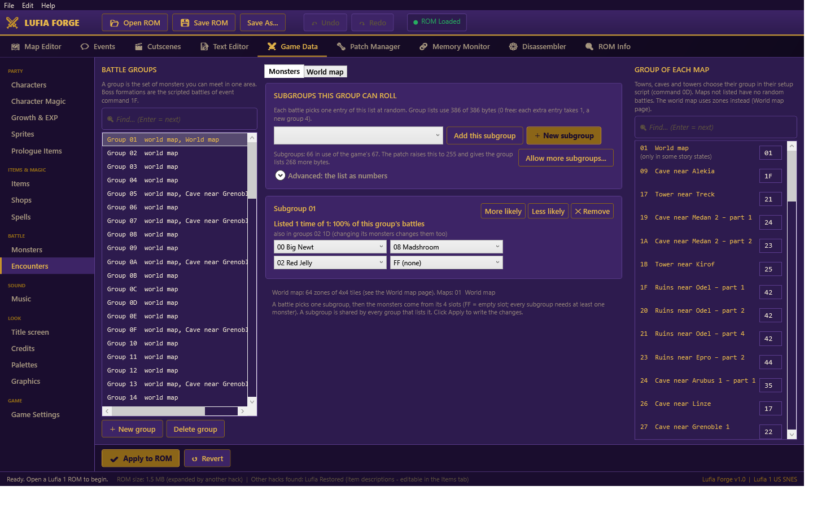

#### Sound

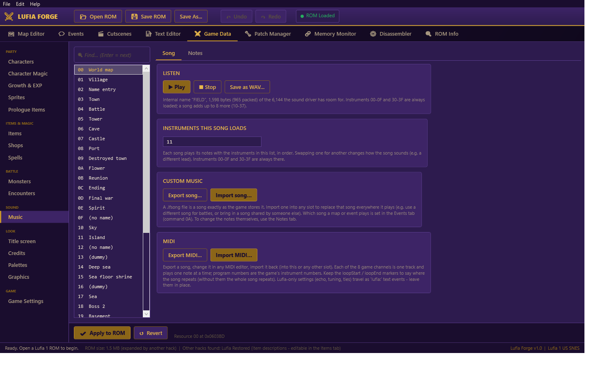

- **Listen** to all 37 songs, played by the game's own sound driver on an emulated SNES sound chip, and **save them as WAV**.
- Change the instruments a song loads.
- **Export and import songs** exactly as the game stores them, into any slot.
- **MIDI export and import:** one track per channel, loop markers, the game's instruments as program numbers.
- **Piano roll:** edit notes, drums, tempo, instruments, volume, pan and loops, with copy and paste, quantize, playback from any point, and undo / redo.

#### Look

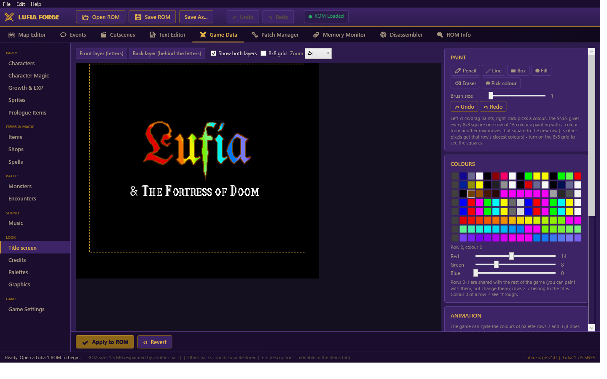

- **Title screen:** paint the logo and the colours behind it (pencil, line, box, fill, eraser, colour picker, undo / redo), edit its colours and the colour-cycling rainbow, export and import the layers as PNG.
- **Credits:** edit every card of the ending's staff roll with a preview as it shows on screen.
- **Palettes:** every map, sprite, battle and monster palette; edit colours as RGB or web colours, export and import as PNG.
- **Graphics:** browse every graphics resource (or raw bytes anywhere) as 2, 4 or 8 bpp with any palette; export and import PNG (resources that grow are moved to free space automatically).

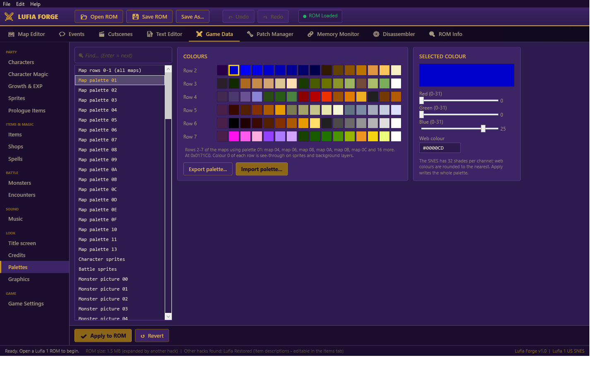 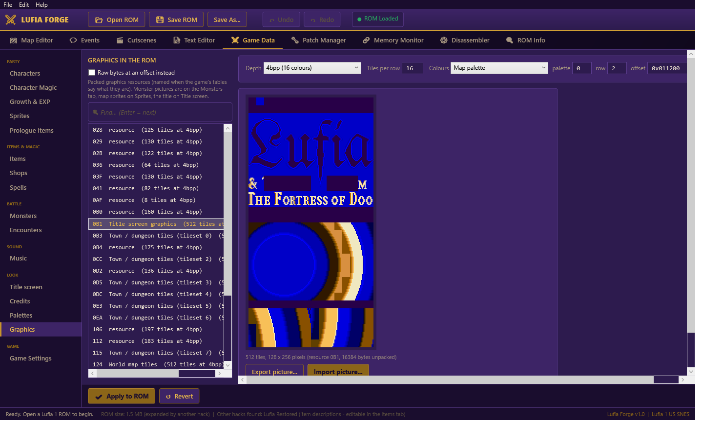

#### Game

- **Game Settings:** fast walking, sailing and flying; random battle rate presets (from Off to More) and safe steps after a battle; swamp damage; max level; the **menu button** (B, Y, Select, Start, X, L or R; FrankCG92's remap); Lufia Restored's faster walking on or off; the ROM's internal title.

---

### Patch Manager

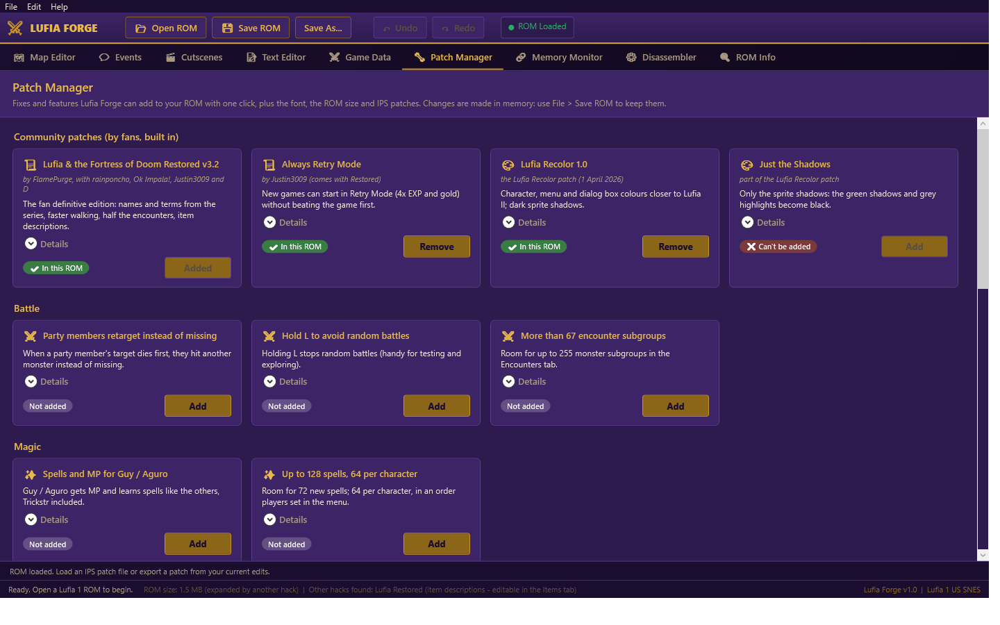

One-click fixes and features, each with a summary, a status badge (In this ROM, Update available, Not added) and an Add / Remove / Update button:

- **The Ancient Cave:** a Lufia 2 style cave of 100 random floors, as its own game, from the Old Cave's elevator, or starting at the elevator. Every floor is built at random with 8 to 12 chests (gear for every depth, stat potions, spells nobody in the party knows yet), monsters follow the party's level, a floor counter, colour themes every 25 floors, a priest who saves and merchants on the way down, and all four Sinistrals at once on floor 100. The **Ancient Cave demo** sets it all up in one click.
- **Visible monsters** and **Lufia 2's battle backgrounds** (see Battle).
- **Battle:** party members retarget instead of missing; hold L to avoid random battles; up to 255 encounter subgroups; **level-ups fill up the HP and MP gained**.
- **Magic:** spells and MP for Guy / Aguro (Trickstr included); up to 128 spells with 64 per character, in an order players set in the field Magic menu (kept in the save).
- **Items:** a 22 KB item bank for bigger item records and new items; status effects on equipment; **historic bows** for Jerin / Artea (five new bows).
- **Events:** a rename command for events (show Maxim's name in a flashback, then give the Hero's back).
- **32 KB cartridge RAM:** 24 KB more RAM for patches; old saves still load.
- **Testing:** test start (skip the opening, start anywhere).
- **Community patches built in:** Lufia & the Fortress of Doom Restored v3.2 (FlamePurge, with rainponcho, Ok Impala!, Justin3009 and D), Always Retry Mode (Justin3009), Lufia Recolor 1.0 and Just the Shadows. Their readmes come with the app.
- **Lufia II's font**, copied from your own Lufia II ROM (and Lufia 1's put back any time).
- **Expand the ROM** to 4 MB.
- **IPS patches:** apply someone's patch (with a warning if it would overwrite your Lufia Forge edits), or export your own edits as an IPS patch to share.

---

## Lufia II: Rise of the Sinistrals

Open a Lufia II ROM and Lufia Forge shows Lufia II's own tools, grouped in a sidebar: World, Battle, Heroes and Other. Every change goes straight into the ROM, with Undo.

### Maps, treasure and the world map

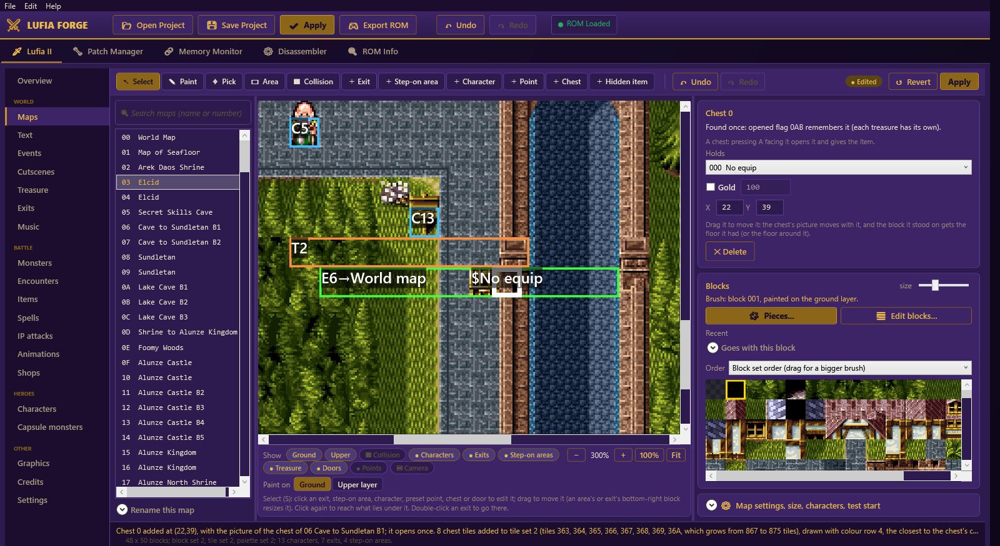

- **Every map**, the world map too, drawn from the game's own data on both layers, edited like Lufia 1's: paint both layers with brushes (Alt + wheel turns the brush), pick, copy, cut, paste and fill areas, **Pieces** from any map with the same block set, your own presets, and **Goes with this block**.
- **Show** ground, upper layer, collision, characters, exits (labelled with where they lead), step-on areas, treasure, doors, preset points and the **camera** (what the screen shows from any spot).
- **Add and move** exits, step-on areas, characters (sprite, how they move, what they say), preset points, chests and hidden items. Drag to move, drag a corner to resize.
- **Block editor**, **resizing** maps, the block set, tile set and palette set, and a **test start** that drops a new game right on the map.
- **Treasure:** new chests and hidden items on any map, each with its own flag so it gives once; chests and hidden items can give **gold** ("Found 1234 GOLD"). A map with no chest can use a **chest picture from any other map**, and **towns can have chests too**: the chest's tiles are copied in from another map's graphics, in the town's closest colours, without changing how any other map looks. Moving a chest moves its picture.
- **The world map** at full size (one game pixel per screen pixel, sharp at every zoom), with its entrances shown as boxes named after where they lead. Add, move and remove **entrances**, and send a town's exit to any spot on the world map.
- **Battle zones:** paint where which battles happen, with every zone's groups and monsters listed beside the map, and add new zones past the game's 17 (up to 256).
- **Up to 128 new map sprites** (any three on one map).
- **Treasure** and **Exits** pages list every chest (and what it holds) and every exit (and where it leads).

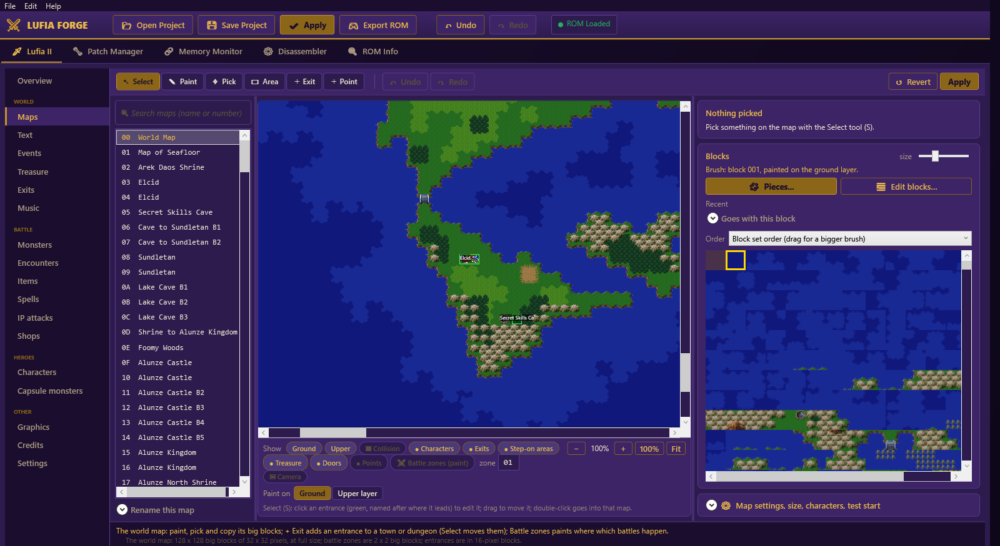 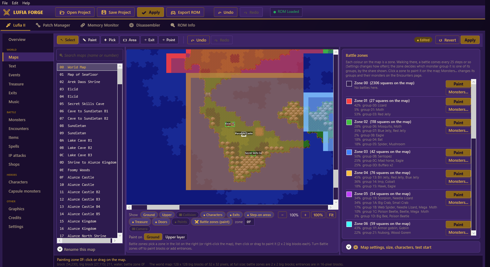

### Cutscenes, events and text

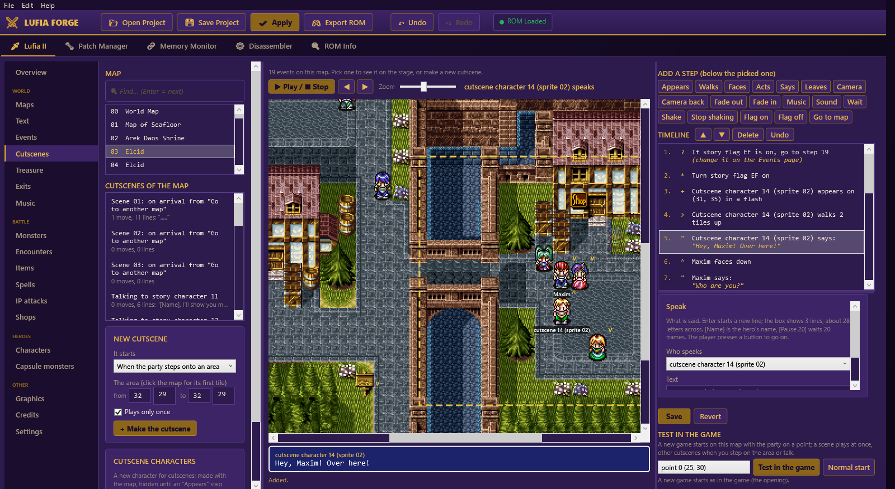

- **Cutscenes:** a map becomes a stage with its characters. Build a cutscene from steps in plain words (appears, walks, faces, acts, says, camera, fades, music, sound, flags, go to another map) and click the map to place them.
- Start it when the party **enters the map**, **steps on an area**, or **talks to a character** (a new one or one of the game's), and make it play only once.
- **Playback in the editor** follows the story flags you tick and takes the branches the game would, saying which one and why; characters face the way they face, with walking frames, and a walk that a wall, another character or a walk area would stop gets a warning and a red box on the map.
- **Test in the game** starts a new game right on the map.
- **Events:** every map's event scripts command by command (205 commands) in plain words, with names, items, songs and conditions written out, edited step by step, and **new events** of your own.
- **Story flags:** all 256, with every script that sets, clears or tests each one.
- **Text:** 5,383 lines of dialogue, found by following the scripts, edited in place.

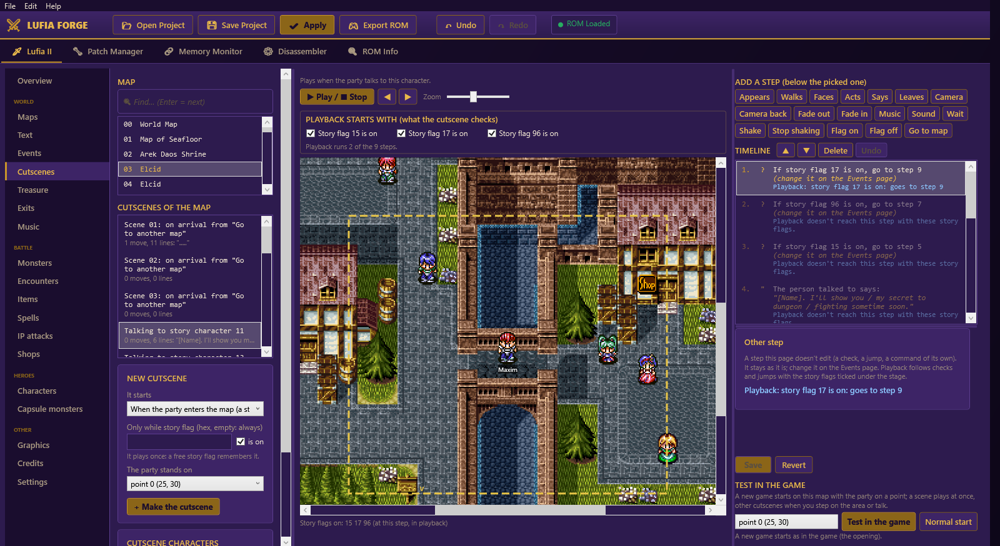

### Battle

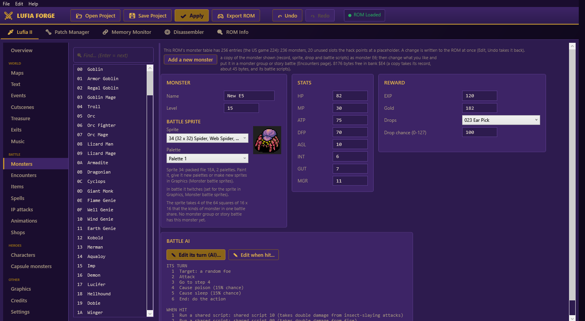

- **Monsters:** stats, rewards, drops, battle picture and **battle scripts** (what a monster does on its turn and when it is hit) as plain steps, edited step by step, with commands, spells, monsters, items, stats and targets picked by name.
- **New monsters:** a copy of any monster with its own name, stats, picture, drop and battle scripts, ready for groups and story battles.
- **Monster battle pictures:** paint them pixel by pixel, PNG in and out, new palettes, **new pictures**, and how each one moves in battle (floats, shakes, twitches). A warning shows when a battle needs more picture room than the game has.
- **Encounters:** zones on a small world map, groups with their chances and monster pictures, monsters picked from a list with pictures, new groups, and **story battles** (the six monsters and their places on the screen).
- **Items, spells and IP attacks:** names, prices, effects, who can use them, and their descriptions; **new spells and IP attacks**, and the effects behind them.
- **16 new statuses** (Zombie, Frozen, Burnt, Berserk, Regen, Doom, Stop, Mana leak and more) that monsters, attacks and items can cause, cure, resist or ward against; **Bounce** (physical hits come back at the attacker) on monsters and items; **focus** for the Tag ring and Tag candy (each attack in a row on one foe hits harder, +10% up to +100%).
- **Monster attacks** with names of your own, monster types, element percentages for monsters, heroes and items, and a **break chance** for every item.
- **Spell animations:** every battle animation plays in the editor exactly as the game plays it. Paint its graphics, change its colours and timing, copy it into a new one and give it to a spell or IP attack. **Weapon swings** can be copied too and given to a weapon, so a weapon can have its own slash (with every hero's version; the preview shows any hero).

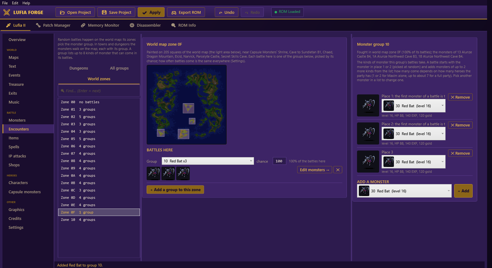 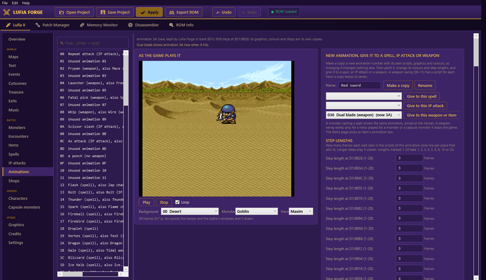

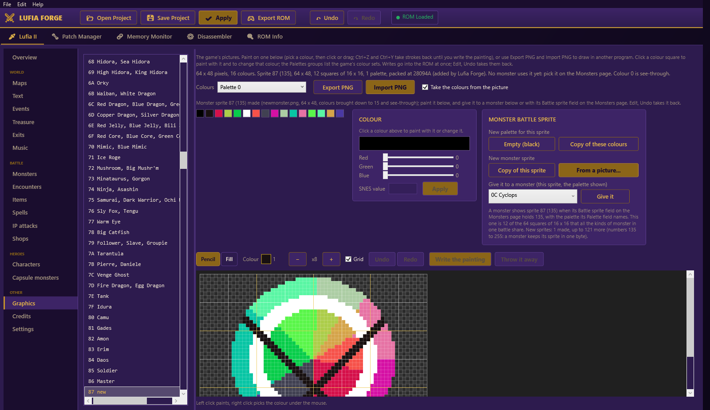

### Heroes and capsule monsters

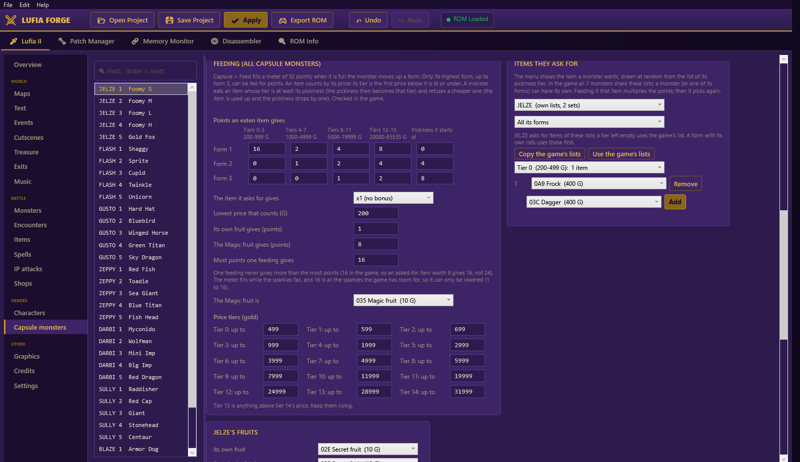

- **Heroes:** starting stats, growth per level on a chart you drag, the EXP curve, and what each hero starts with (level, spells, equipment).
- **Capsule monsters:** all 7 in all 5 forms: names, type, attacks, level-1 stats, growth, battle scripts and pictures.
- **Feeding:** points per item and form, the bonus for the item a capsule monster asks for, pickiness, price tiers, its own fruit and the Magic fruit, and what any item gives.
- **Wish lists:** each capsule monster, and each of its forms, can ask for its own items.

### Shops, music, graphics and settings

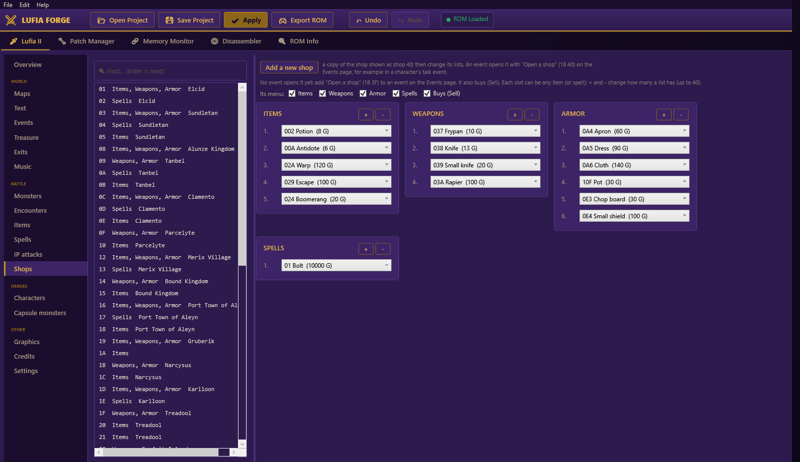

- **Shops:** what every shop sells, **new shops**, and longer shop lists. Open a shop from any event, for example a character's talk event.
- **Music:** all 63 songs play inside Lufia Forge on Lufia II's own sound driver; export any song as MIDI and import a MIDI file as a song.
- **Graphics:** battle backgrounds, capsule monsters, hero battle sprites, monster pictures, the title screen, fonts, menu and battle graphics, and every map sprite: paint, export to PNG, edit, import back. A palette editor for every palette set the game uses.
- **Credits:** the staff roll as plain text.
- **Settings:** random battle rate, world map walking speed, walking in towns (normal, run with R, always fast), the selling price and the level cap.
- **8 MB ROMs** (Settings > ROM SIZE) for big projects: about 2 MB more room for events and cutscenes. Plays in Snes9x, bsnes and BizHawk's BSNESv115+ core.
- **Snes9x 1.51 mode** (Edit > Settings, on unless you turn it off): nothing is written to the last 2 MB of an 8 MB ROM, which Snes9x 1.51 / 1.52 can't read, and what an older Lufia Forge put there is moved. [More in the merge guide](docs/merge-projects.md#snes9x-151-mode-edit--settings).
- The garbled shrine maps of the US version (CF and F1) are fixed the way the European release fixed them.

### Fan hacks

- **Frue Lufia, Spekkio Lufia, Kureji Lufia and The Wrath of Foomy** (v8.2) are built into the Patch Manager, each added to a clean ROM in one click.
- Lufia Forge reads and edits them in full: every added monster, shop, battle script and description, where their own code keeps it.
- **Tidy the hack's data** (Settings > HACK DATA) moves the battle scripts Spekkio and Kureji keep inside other monsters' names to space of their own, so their monsters can have full 13-letter names again. Everything is checked to read the same before anything is written.
- **Make room for new monsters** moves a hack's full monster bank to a bigger one: 20 new monsters in Spekkio, 23 in Kureji, 31 in Frue and Foomy.

### Lufia II Patch Manager

- Hold B to avoid random battles, fast walking on the world map, fast walking in towns, hold R to run, free inns, a faster IP gauge.
- Expand the ROM to 4 MB (or 8 MB from Settings).
- The fan hacks above.

---

### Memory Monitor and BizHawk

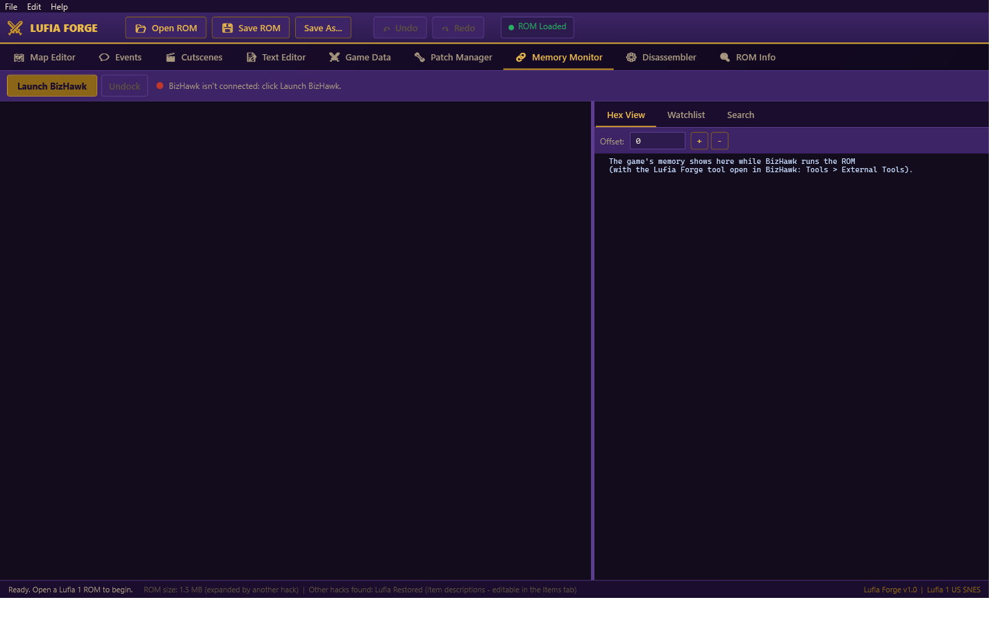

- **Launch BizHawk** (included) with the project's ROM, docked right inside the window, or undocked to float on top.
- **Live memory view** of the game's RAM, refreshed 30 times a second.
- **Watchlist** with a catalog of known addresses for Lufia 1 and Lufia II (map, position, HP, MP, gold, EXP, stats, items...), your own labels, and current, previous and change columns.
- **Value search** (cheat-finder style) to find any value in memory.
- The **Lufia Forge Monitor** tool inside BizHawk powers live flags, the cutscene "follow the game" playhead and the disassembler's "follow PC".

### Disassembler

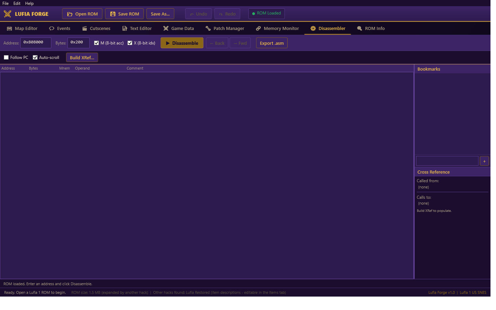

- 65816 disassembly from any SNES address or file offset, with back / forward navigation and export to .asm.
- **Follow PC** shows the code BizHawk is running right now.
- Follow jumps, bookmarks saved per ROM, a cross reference (called from / calls to), mark data, send addresses to the watchlist.

---

## Thanks

Lufia Forge builds on the work of the Lufia community: FlamePurge and everyone behind Lufia Restored, the Lufia Recolor patch, Artemis for the Lufia II fan hacks and all the feedback, FrankCG92, Justin3009, rainponcho, Ok Impala!, D, and the authors of L1ME. See Help > About & Thanks in the app for the full list.

## Feedback

This repository holds only the release files. Report problems or ideas on the [Issues](https://github.com/TequilaJosh/Lufia-Forge-Releases/issues) page: what you did, what you expected, and a save state if you can.

Lufia &amp; the Fortress of Doom and Lufia II: Rise of the Sinistrals are © Taito / Neverland. Lufia Forge is an unofficial fan tool and includes no game data; use it with your own copy of the game.
