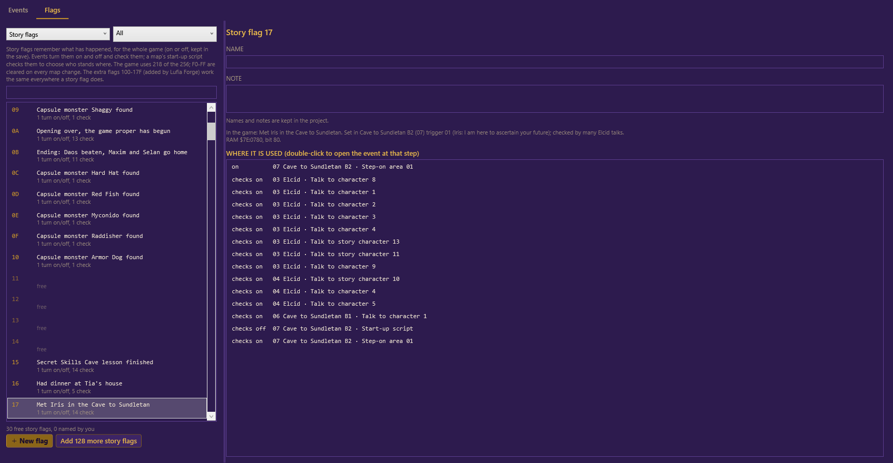
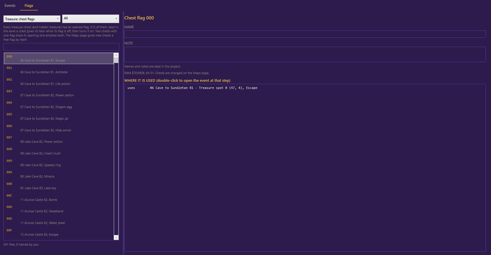
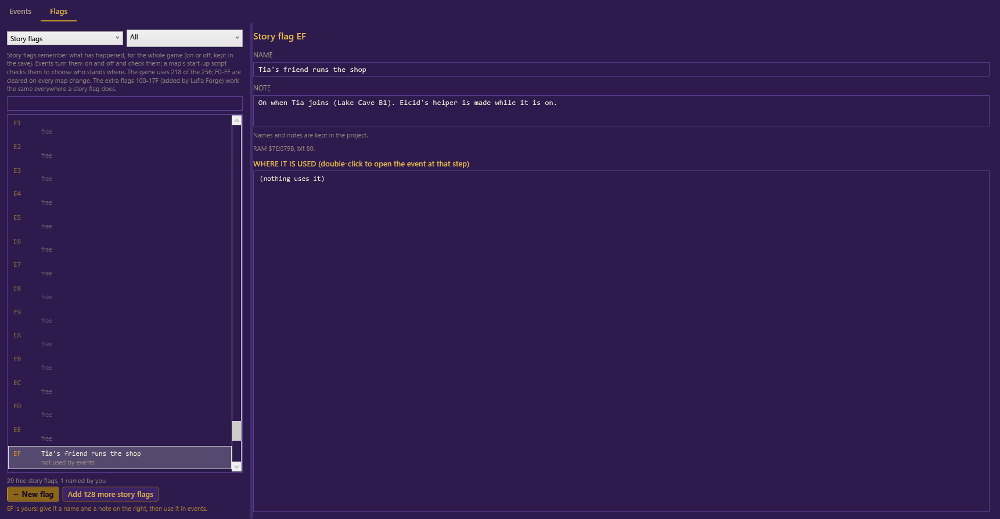
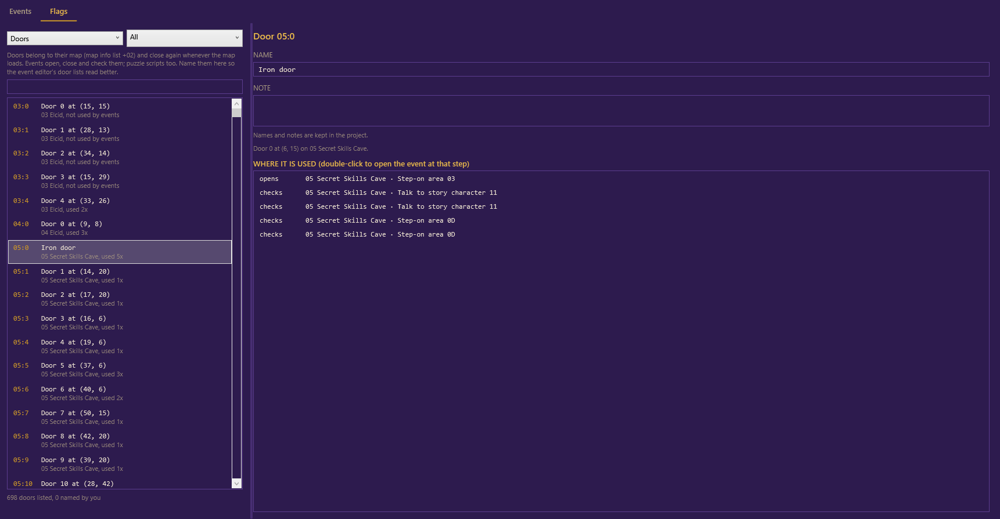
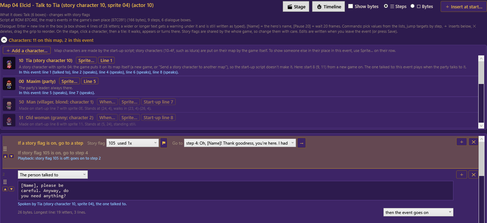
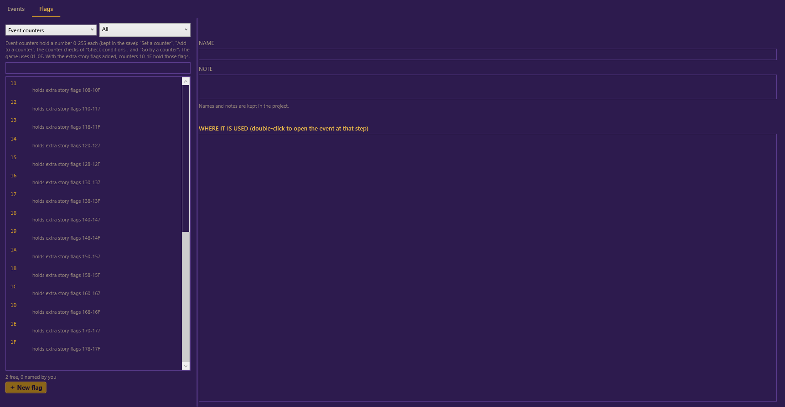
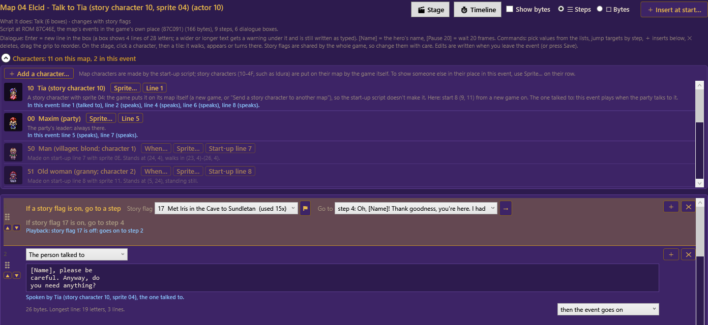
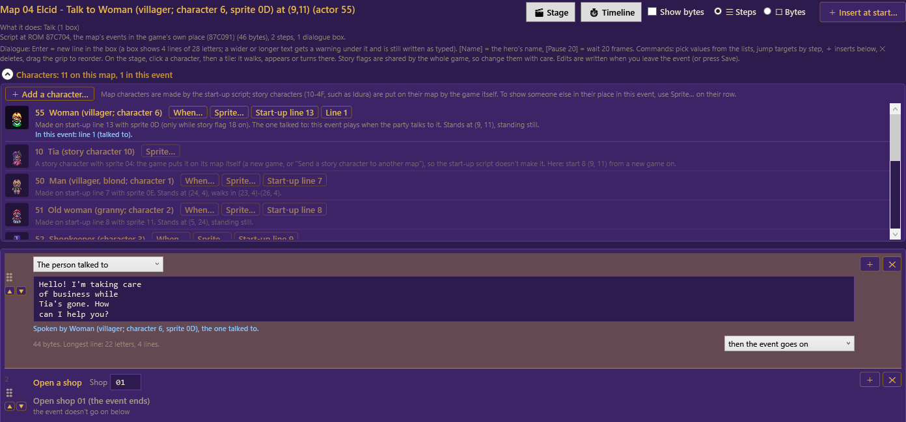
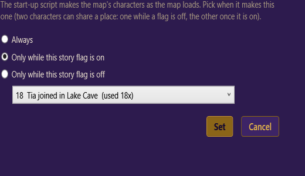
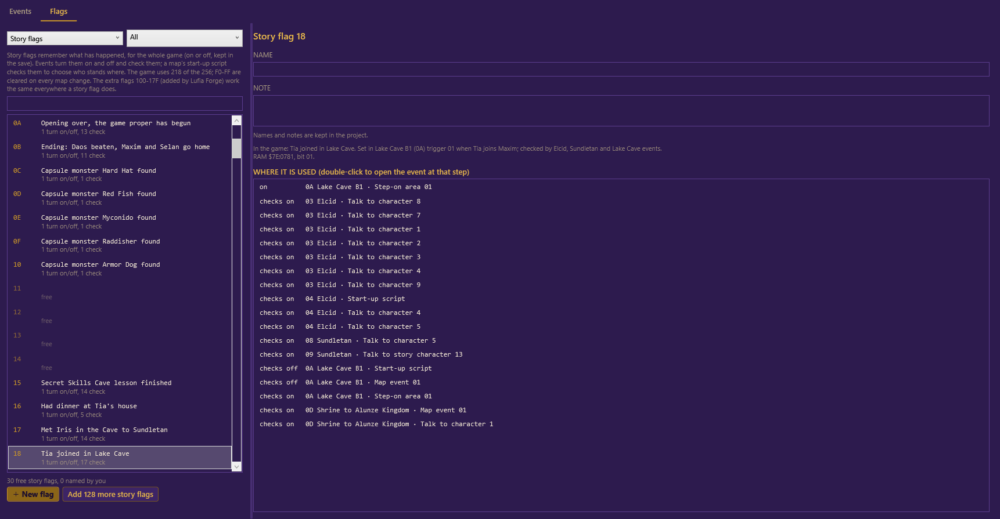

# Flags and NPCs in Lufia II

How the game remembers what happened, how to make your own flags, and how to make characters say other things, show up, disappear or be replaced as the story goes on.

*The Flags tab is in Lufia Forge 0.4.0-beta.29 and later (Lufia II, Events page). [Download the latest release](https://github.com/TequilaJosh/Lufia-Forge-Releases/releases).*

**Contents:** [The Flags tab](#the-flags-tab) · [Your own flags](#your-own-flags) · [128 more story flags](#128-more-story-flags) · [NPCs that change with the story](#npcs-that-change-with-the-story) · [Example: Tia's shop in Elcid](#example-tias-shop-in-elcid) · [Good to know](#good-to-know)

---

## The Flags tab

Open the **Events** page and pick the **Flags** tab. The list at the top left chooses the kind of flag:

| Kind | What it is |
|---|---|
| **Story flags** | On/off switches that remember what has happened, for the whole game, kept in the save. Events turn them on and off and check them; a map's start-up script checks them to choose who stands where. |
| **Event counters** | A number 0-255 each, kept in the save. The game uses counters 01-0E. |
| **Treasure chest flags** | Every chest and hidden item has one (512 in all): it gives its item while the flag is off, then turns it on. |
| **Puzzle switches** | The on/off flags of puzzle scripts. 00-1F are kept in the save and shared by every map; 20 and up belong to the map that uses them. |
| **Doors** | Each map's doors. They close again whenever the map loads. |

Pick a flag and the right side shows what the game uses it for, where it lives in RAM, and **every place it is used**. Double-click a use and the event opens on the Events tab, at that exact step.

The second list chooses **All**, **Used**, **Free** or **Named by you**, and the search box finds a flag by number, name, note, map or item.

## Your own flags

Every flag can have a **name** and a **note** of your own. Type them on the right; they are saved in your project (and come along when you [merge projects](merge-projects.md)).

Your names show up in the event editor too: a step reads *"If story flag EF (Tia's friend runs the shop) is on"*, and the story flag and door lists show your names.

To get a flag nothing in the game uses, press **+ New flag**. Lufia Forge takes a free one (story flags from EF down), gives it a name like "My flag EF" and picks it: change the name and add a note saying what it means.

Doors can be named too, so "Open a door" lists "door 0 (6,15) Iron door" instead of a number.

## 128 more story flags

The game's own events use 218 of its 256 story flags, so only about 30 are left for your story. Press **Add 128 more story flags** on the Flags tab (or New flag adds them by itself when the free ones run out).

- The new flags are numbered **100-17F** and work everywhere a story flag does: "Turn a story flag on/off", "If a story flag is on/off", Check conditions, When... (who stands on a map), playback on the stage and Test in the game.
- Pick one in any story flag field and Lufia Forge writes the right command for it.
- They are kept in event counters 10-1F, which the game never uses and already keeps in the save. Old saves load fine, with every extra flag off.
- Once they are in, don't use counters 10-1F as counters: a counter step on them shows a warning. Use counter 0F or below.

## NPCs that change with the story

Lufia II does all of this with story flags. There are three tools.

### 1. Different lines: flag checks in the talk event

On the Events page, pick the map and the NPC's **Talk to ...** event. Add a check with **+ > If a story flag is on, go to a step**, pick the flag, and pick the step it jumps to. Put each version of the text after its own check, and end each version (End of the event, or a shop).

With several checks in a row, put the latest point in the story first. In Elcid, character 4 checks flag 18, then 17, then 96, then says the oldest line.

### 2. Show or hide an NPC: the When... button

Ordinary townspeople are **map characters**: the map's start-up script makes them as the map loads. Open any event on that map, expand the **Characters** section, and press **When...** on the NPC:

- **Always**
- **Only while this story flag is on**
- **Only while this story flag is off**

This is checked when the map loads, so the player sees the change the next time they walk in. To make someone vanish (or appear) in front of the player, use **Hide a character** / **Show a character** in an event.

Two NPCs can share one spot: one "only while the flag is off", the other "only while it is on".

### 3. Story characters: Send a story character to another map

Some characters, like Tia, aren't made by the start-up script. They are **story characters** (numbers 10-4F): the game remembers which map each one is on, and their row in Characters says so. Move or remove one with **Send a story character to another map**, and send them back later the same way.

## Example: Tia's shop in Elcid

Open map **04 Elcid** to see all three at work.

1. **Tia's lines** change with story flag 17: before it she says "please be careful", after it she talks about her weird feeling.
2. **Tia leaves:** when she joins the party in Lake Cave B1, that event does *Tia joins the party*, then *Send a story character to another map* (out of the way), then *Turn story flag 18 on*.
3. **The shop is empty for a while:** an earlier event in Lake Cave B3 already sent Tia away, and flag 18 only goes on when she joins.
4. **Her friend takes over:** Elcid's character 6 is made **only while story flag 18 is on**, and her talk event says "I'm taking care of business while Tia's gone."

To build the same thing yourself:

1. On the Flags tab, press **New flag** twice and name them, for example "Tia left" (A) and "Her friend took over" (B).
2. In the event where she leaves: **Send a story character to another map** for her (or **When... only while A is off** if she is a normal townsperson), then **Turn a story flag on** for A.
3. In a later event: **Turn a story flag on** for B.
4. **+ New event... > Talking to a new character**: click her spot, pick the friend's sprite and type the first line. That makes the friend and their talk event in one go.
5. In **Characters**, press **When...** on the friend: only while B is on.

## Good to know

- **When... refuses an NPC the start-up script makes in more than one place** (with other sprites under other flags). Edit those lines in the start-up script itself.
- **Sprite...** on a character changes how they look in one event only. For a change that stays, use two characters with When...
- **Test it:** tick story flags under the stage to play the event with them on, and **Test in the game** starts a new game with those flags on.
- **F0-FF** are cleared on every map change, and a few story flags are used by the game's own code (the Flags tab says which): don't use those for your story.
- A map can have up to 32 characters.
