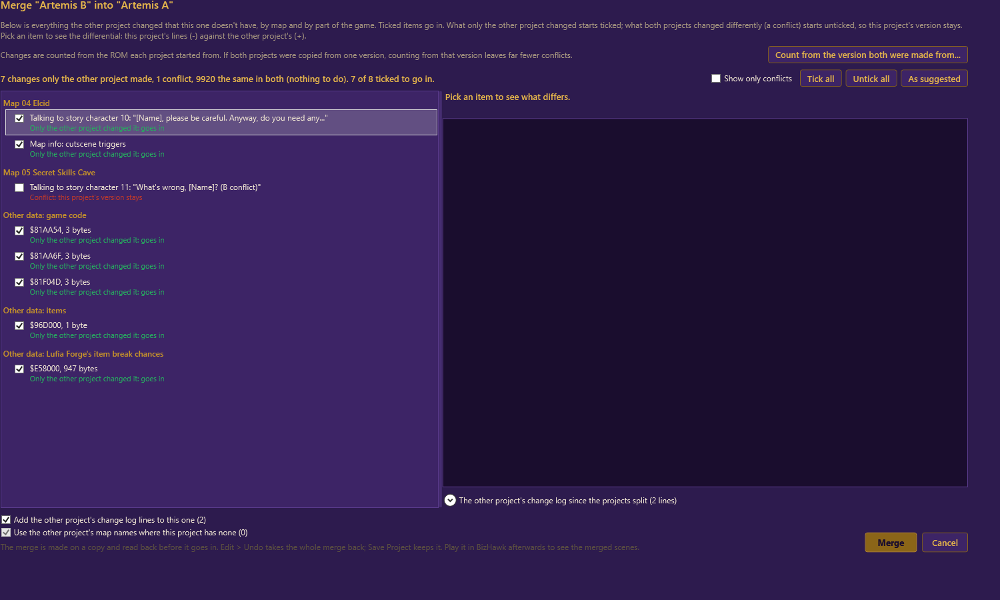
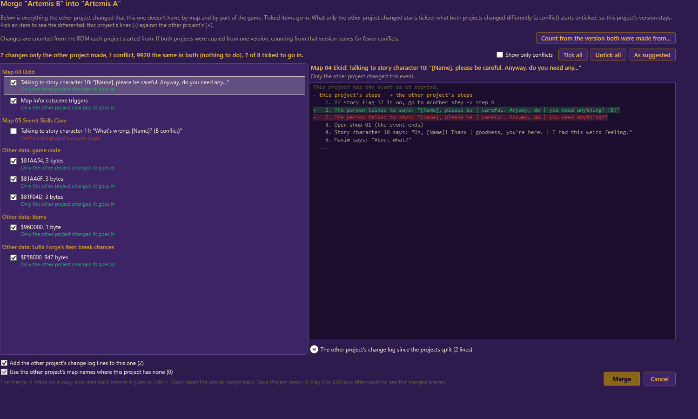
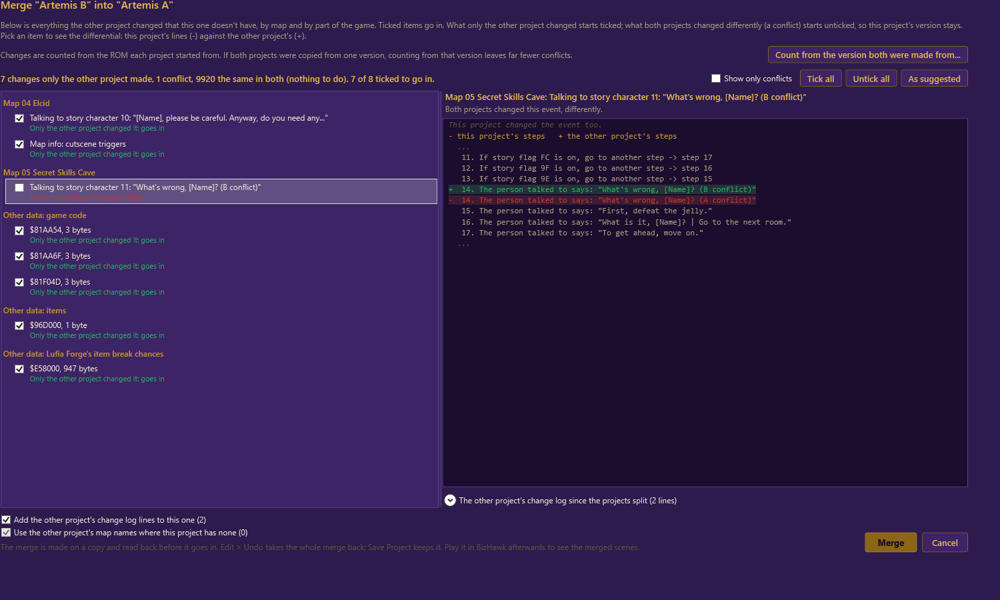
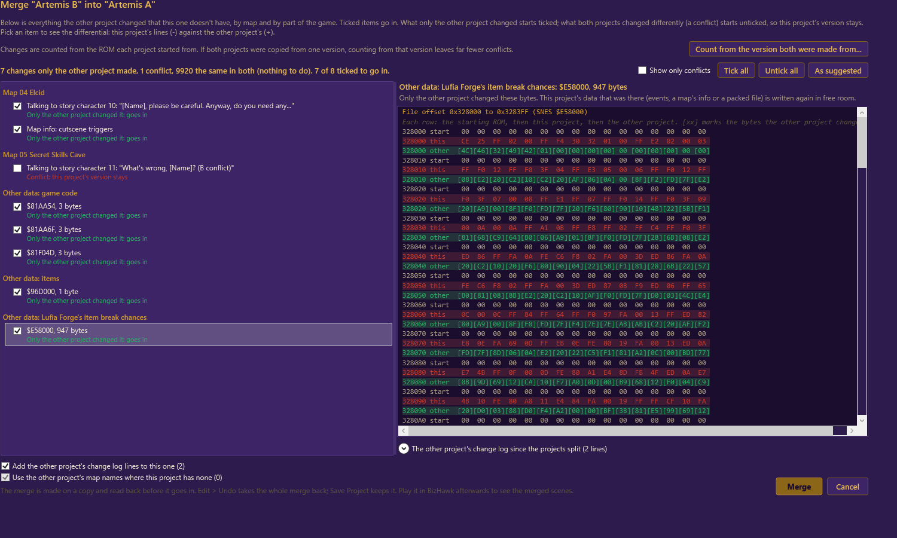
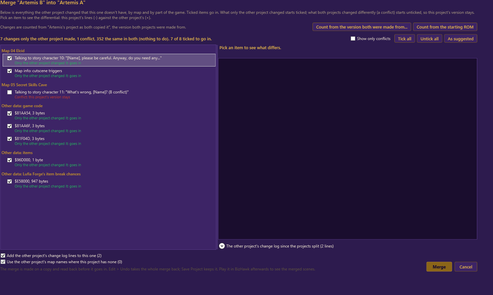
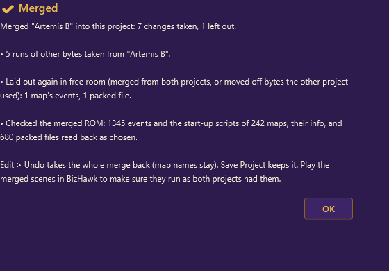

# Merging Lufia Forge projects

Bring the work from one project into another, see every difference before it goes in, and keep the final say on each one.

*File > Merge Another Project Into This One, in Lufia Forge 0.4.0-beta.25 and later. [Download the latest release](https://github.com/TequilaJosh/Lufia-Forge-Releases/releases).*

**Contents:** [When to use it](#when-to-use-it) · [What to have ready](#what-to-have-ready) · [Step by step](#step-by-step) · [Good to know](#good-to-know)

---

## When to use it

- **A team, one hack.** Each person works on their own copy of the project. One person writes the story events, another fixes monsters. Now and then one of you merges the others' projects into the main one.
- **A test copy.** You made a copy to try something out (File > New Project From This One) and kept working in the original meanwhile. Merge brings the parts of the test copy you liked back.

## What to have ready

- **The project you want to end up with**, open in Lufia Forge. This is "this project" in the merge window.
- **The other project's .lfproj file** (or a ROM). Lufia Forge only reads it; it never changes it.
- **Best of all: the version both projects were copied from.** If you both started from the same project file, keep that file. With it, Lufia Forge can tell what was already there before you split, and you get far fewer conflicts.
- **A safety copy of your project:** File > New Project From This One, or just copy the .lfproj file somewhere. A merge can be undone, but a spare copy never hurts.

## Step by step

### 1. Open the merge from the File menu

With your project open, choose **File > Merge Another Project Into This One...** and pick the other project (or a ROM file). Lufia Forge first takes in any edits still open on its pages, then compares the two. That can take a few seconds on a big hack.

If the other project has nothing yours doesn't already have, Lufia Forge tells you so and stops there.

### 2. Read the list

The window lists everything the other project changed that yours doesn't have. It is grouped by map (each event on its own, the map's info such as cutscene triggers, its layout) and by part of the game (game code, items, Lufia Forge's own patches by name, and so on).

*Merging "Artemis B" into "Artemis A" (two test copies of one hack): seven changes only B made, ticked, and one conflict on map 05, unticked. The line of numbers at the top is worded a little differently in the released version.*

Each line has a tick box and a short status under it:

| Status | What it means |
|---|---|
| **Only the other project changed it: goes in** | You didn't touch it, so taking theirs is safe. These start ticked. |
| **Conflict: this project's version stays** | You both changed it, differently. These start unticked, so nothing of yours is replaced unless you decide so. |
| **Conflict: the other project's version goes in** | A conflict you ticked. |
| **Only the other project changed it: left out** | A change you unticked. |

**Ticked means the other project's version goes in. Unticked means yours stays.**

### 3. Click an item to see what differs

The right side shows the difference for the item you picked: **red** lines are this project's, **green** lines are the other project's, and gold lines are headings.

*Events are shown step by step, as in the event editor. Here only the other project changed one line of text on map 04. Unchanged steps around it are shown for context, and "..." stands for the rest.*

*A conflict: both projects changed step 14 of the same event. Read both lines, then tick the item if you want the other project's version, or leave it unticked to keep yours.*

Map info is shown record by record. Anything Lufia Forge can't put into words is shown in hex, three rows at a time: **start** (the starting ROM), **this** (your project) and **other**, with the other project's changed bytes in [brackets].

*The hex view of the other project's item break chances patch. The line at the top explains that this project's data that was in that spot is written again in free room, so it isn't lost.*

### 4. Count from the shared version (if you have it)

At first, changes are counted from the ROM each project started from. That means anything changed before you split, and then changed again by either of you, looks like a conflict.

Click **Count from the version both were made from...** and pick the project file (or ROM) both projects were copied from. The list is worked out again. The line above the list then names that version, and **Count from the starting ROM** goes back to the first way.

*In this small test the list stays the same, but on a real hack it can make a big difference: on two versions of one hack, 152 conflicts went down to none.*

### 5. Decide what goes in

Tick or untick items one by one, or use the buttons above the list:

- **Show only conflicts:** hides everything that isn't a conflict, so you can go through the hard ones.
- **Tick all:** the other project's version of everything, conflicts too.
- **Untick all:** nothing goes in; your versions stay. Handy when you only want a few things: untick all, then tick those.
- **As suggested:** back to the starting choice: what only the other project changed goes in, conflicts keep yours.

Under the list, **The other project's change log since the projects split** shows what its author wrote down, which helps you understand what each change was for.

### 6. Choose what comes along

Two boxes at the bottom left, both ticked at first:

- **Add the other project's change log lines to this one.** Their lines are added to your change log, each starting with (from "their project").
- **Use the other project's map names where this project has none.** Names you already gave a map are never replaced.

### 7. Merge and read the report

Click **Merge**. Lufia Forge builds the result on a copy, reads every event, map info list and packed file back to make sure they came out as you chose, and only then puts it in your project. A report says what was taken and what had to be moved.

*"Laid out again in free room" means Lufia Forge moved something so both projects' data fit.*

### 8. Check it, then save

- The whole merge is **one Undo step**: Edit > Undo takes all of it back. Map names that came along stay.
- **Play the merged scenes** in BizHawk (or your emulator) to make sure they run as both projects had them.
- Happy with it? **Save Project.** Until you save, the merge isn't in the project file.

---

## Good to know

### "Same place in the free space"

When two projects split, both put their new data in the same free space, because each one thought it was empty. Lufia Forge handles that by itself for events, map info and packed files (map layouts, music, graphics): it moves one side's copy to free room.

Other new data both projects put at the same spot, such as two different patches, is a real conflict. The item says so, and Merge asks again before you take it. Only one side can keep that spot, so whoever's change loses has to make it again after the merge.

### New maps

New maps made in only the other project come along as they are. If both projects made new maps, the map numbers clash: only this project's new maps are kept, and a warning at the top of the window says so. Make the other project's new maps again after the merge.

### Lufia 1 projects

Lufia 1 is merged byte by byte, with the same window, ticks and conflicts. New blocks both projects put at the same place in the added space show as a conflict.

### Merging a ROM

You can pick a ROM instead of a project. It is compared as if it started from the same ROM as your project. A ROM brings no change log or map names.

> **Tip:** merge often. Two projects that split a week ago have a handful of conflicts; two that split months ago can have hundreds.

---

*Screenshots are from a test merge of two copies of one hack ("Artemis A" and "Artemis B").*
